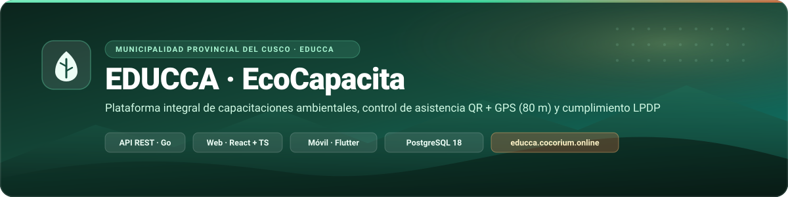
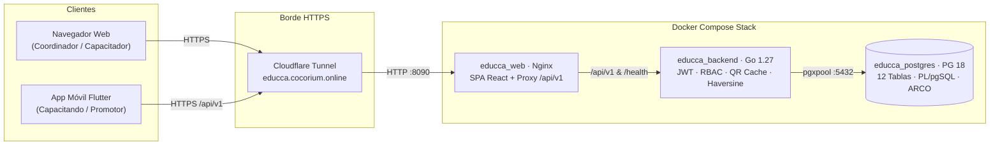
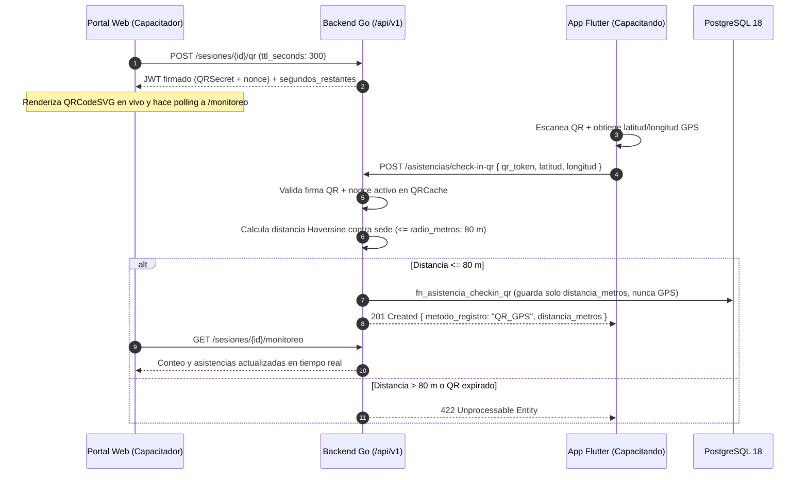

<a id="readme-top"></a>

<div align="center">
  

  <br />
  <br />

  <p>
    <strong>Sistema integral de gestión operativa, seguimiento en tiempo real y control de asistencia geolocalizada</strong><br />
    para el Programa Municipal de Educación, Cultura y Ciudadanía Ambiental (EDUCCA) — Cusco.
  </p>

  <p>
    <a href="https://educca.cocorium.online" target="_blank">
      
    </a>
    
    
    
    
    
  </p>

  <p>
    <a href="#arquitectura-del-sistema">Arquitectura</a> •
    <a href="#módulos-del-ecosistema">Módulos</a> •
    <a href="#despliegue-rápido-con-docker--cloudflare">Despliegue Docker</a> •
    <a href="#desarrollo-local-por-módulo">Desarrollo Local</a> •
    <a href="#roles-rbac-y-credenciales">Roles RBAC</a> •
    <a href="#referencia-de-api-rest">API REST</a> •
    <a href="#estructura-y-comandos">Makefile</a>
  </p>
</div>

---

## Módulos del Ecosistema

<table>
  <tr>
    <td width="50%" valign="top">
      <h3>⚙️ Backend REST (<code>backend/</code>)</h3>
      <p>API REST construida en <strong>Go 1.27</strong> con arquitectura modular, autenticación JWT (acceso + refresh), <strong>RBAC fail-closed</strong> por permiso granular, generación/revocación de tokens <strong>QR dinámicos</strong> en caché aislada y cálculo geodésico <strong>Haversine (80 m)</strong> sin almacenar coordenadas del ciudadano.</p>
      <p><a href="./backend">Explorar <code>backend/</code> →</a></p>
    </td>
    <td width="50%" valign="top">
      <h3>🖥️ Portal Web Administrativo (<code>web/</code>)</h3>
      <p>Aplicación SPA en <strong>React 18, TypeScript, Vite y CSS Modules</strong> orientada a <strong>Coordinadores</strong> y <strong>Capacitadores</strong>: catálogo de sedes georreferenciadas, metas anuales MINAM, programación y validación de talleres, emisión de QR dinámico en vivo, calificaciones, conciliación y exportación CSV sanitizada.</p>
      <p><a href="./web">Explorar <code>web/</code> →</a></p>
    </td>
  </tr>
  <tr>
    <td width="50%" valign="top">
      <h3>📱 App Móvil Ciudadana (<code>mobile/</code>)</h3>
      <p>Aplicación <strong>Flutter</strong> para participantes y promotores ambientales (<code>PAC</code>, <code>PAJ</code>, <code>COMERCIANTE</code>, <code>RECICLADOR</code>) con registro ciudadano LPDP (mayoría de edad <code>>= 18</code>), inscripción a talleres, escáner <strong>QR + GPS</strong> y consulta de historial personal.</p>
      <p><a href="./mobile">Explorar <code>mobile/</code> →</a></p>
    </td>
    <td width="50%" valign="top">
      <h3>🗄️ Base de Datos e Infra (<code>database/</code> + Docker)</h3>
      <p>Esquema relacional <strong>PostgreSQL 18</strong> consolidado en <code>AmbiData.sql</code> (12 tablas, funciones almacenadas PL/pgSQL, control de solapamiento horario y derechos <strong>ARCO</strong>) desplegado en contenedores con <strong>Nginx</strong> y <strong>Cloudflare Tunnel</strong>.</p>
      <p><a href="./database">Explorar <code>database/</code></a> · <a href="./docker-compose.yml">Ver <code>docker-compose.yml</code> →</a></p>
    </td>
  </tr>
</table>

---

## Arquitectura del Sistema



---

## Despliegue Rápido con Docker & Cloudflare

> [!IMPORTANT]
> La forma recomendada de levantar todo el ecosistema (PostgreSQL 18 + API Go + Portal Web + Túnel Cloudflare) en un entorno real de pruebas es mediante **Docker Compose**.

```bash
# 1. Regenerar AmbiData.sql, construir imágenes y levantar los 4 servicios
make docker-up

# 2. Verificar estado del servicio por HTTPS
curl https://educca.cocorium.online/health
# => {"database":"connected","service":"educca-api","status":"ok"}
```

<details>
<summary><b>🐳 Detalles de contenedores, puertos y variables de despliegue</b></summary>
<br />

| Contenedor | Imagen / Build | Puerto Host | Rol en la arquitectura |
|---|---|---|---|
| `educca_postgres` | `postgres:18-alpine` | `5433` → `5432` | Base de datos inicializada automáticamente con `database/AmbiData.sql`. |
| `educca_backend` | `backend/Dockerfile` | `8080` → `8080` | API REST Go con healthcheck en `/health` y CORS habilitado para `educca.cocorium.online`. |
| `educca_web` | `web/Dockerfile` | `8090` → `80` | Bundle de producción React + Nginx reverse proxy hacia `backend:8080`. |
| `educca_cloudflared` | `cloudflare/cloudflared:2026.10.0` | `network_mode: host` | Expone `http://127.0.0.1:8090` en `https://educca.cocorium.online` sin IP pública fija. |

```bash
# Ver logs en tiempo real
make docker-logs

# Detener el stack
make docker-down

# Reiniciar limpiando volumen de PostgreSQL desde cero
make docker-reset
```

</details>

---

## Desarrollo Local por Módulo

Despliega el módulo en el que vayas a trabajar:

<details>
<summary><b>⚙️ Backend Go + PostgreSQL (Local)</b></summary>
<br />

**Requisitos:** Go `1.27+`, PostgreSQL `18+` (`psql`), `make`.

```bash
# 1. Crear archivo de entorno a partir del ejemplo
cp backend/.env.example backend/.env

# 2. Instalar dependencias Go, regenerar AmbiData.sql y crear la BD desde cero
make setup

# 3. Iniciar la API REST en http://localhost:8080
make run_b
```

Variables clave en `backend/.env`:
* `DB_HOST`, `DB_PORT`, `DB_NAME`, `DB_USER`, `DB_PASSWORD`, `DB_SSLMODE`
* `CORS_ALLOWED_ORIGINS` (incluye `https://educca.cocorium.online` y orígenes `localhost`)
* `ACCESS_SECRET`, `REFRESH_SECRET`, `QR_SECRET`, `QR_TTL_SECONDS` (`300` s por defecto)
* `PRIVACY_POLICY_VERSION` (`v1.0-2026`)

</details>

<details>
<summary><b>🖥️ Frontend Web — React 18 + TypeScript + Vite</b></summary>
<br />

**Requisitos:** Node.js `20+` y `npm`.

```bash
cd web
cp .env.example .env
npm install
npm run dev        # http://localhost:5173
```

Para compilar y previsualizar producción:
```bash
npm run build      # tsc && vite build
npm run preview
```

Variables en `web/.env`:
```env
# Apunta al subdominio de pruebas o a http://localhost:8080/api/v1 en local
VITE_API_BASE_URL=https://educca.cocorium.online/api/v1
VITE_DEFAULT_DATA_MODE=api
```

</details>

<details>
<summary><b>📱 App Móvil — Flutter (Android / iOS)</b></summary>
<br />

**Requisitos:** Flutter SDK estable (`3.x+`).

```bash
cd mobile
flutter pub get
flutter test       # Ejecuta pruebas unitarias y de widgets
flutter run
```

> [!NOTE]
> La URL base por defecto en `mobile/lib/config/app_config.dart` apunta a `https://educca.cocorium.online/api/v1`. Desde el diálogo **Ajustes de Conexión** en la pantalla de inicio de sesión se puede alternar en caliente hacia el emulador local (`http://10.0.2.2:8080/api/v1`) sin recompilar.

</details>

---

## Flujo Técnico: QR Dinámico, Geocerca 80 m y LPDP

<details>
<summary><b>📡 Ver diagrama de secuencia e interoperabilidad Web ↔ Go ↔ Flutter</b></summary>
<br />



* **Privacidad por diseño (Ley N.° 29733 / D.S. N.° 016-2024-JUS):** las coordenadas GPS del ciudadano se procesan únicamente en memoria RAM para calcular la distancia Haversine; en PostgreSQL solo se persiste `distancia_metros`.
* **Derechos ARCO:** cualquier usuario puede exportar su expediente completo (`GET /api/v1/arco/personas/{id}/exportar`) y un coordinador/admin puede ejecutar anonimización irreversible (`POST /api/v1/arco/personas/{id}/anonimizar`) preservando los indicadores agregados del programa.

</details>

---

## Roles RBAC y Credenciales

> [!TIP]
> **Usuario administrador semilla** (`database/data/04_persona.sql`):
> * **Identificador (`email` o `dni`):** `admin@educca.gob.pe` o `00000000`
> * **Contraseña:** `password123`

<details>
<summary><b>🔐 Ver matriz de roles y responsabilidades del sistema</b></summary>
<br />

| Rol (`rol.nombre`) | Plataforma | Responsabilidades y alcance RBAC |
|---|---|---|
| **`admin`** | Web / API | Acceso total a todos los módulos, administración de usuarios, roles (`roles:gestionar`), permisos y ARCO. |
| **`coordinador`** | Web / API | Gestión de metas anuales MINAM, sedes georreferenciadas, catálogo de talleres, validación/cancelación de sesiones (`sesiones:validar`), reportes y atención ARCO. |
| **`capacitador`** | Web (Panel QR) | Ejecución de talleres asignados, emisión/rotación/revocación de códigos QR (`sesiones:qr`), monitoreo en vivo, asistencias manuales, calificaciones y evidencias. |
| **`capacitando`** | App Móvil | Ciudadano participante (`COMERCIANTE`, `RECICLADOR`, `PAC`, `PAJ`), registro con consentimiento LPDP (`>= 18` años), inscripción a talleres y check-in QR+GPS. |
| **`consulta`** | Web (Solo lectura) | Visualización de catálogo de sedes/talleres/sesiones y exportación de reportes agregados sin acceso a edición ni PII. |

</details>

---

## Referencia de API REST

Base URL en producción/pruebas: `https://educca.cocorium.online/api/v1`

<details>
<summary><b>🔑 Salud y Autenticación (Público / Bearer JWT)</b></summary>
<br />

| Método | Endpoint | Descripción |
|---|---|---|
| `GET` | `/health` | Estado del servicio API y conectividad a PostgreSQL. |
| `POST` | `/api/v1/register` | Registro público de `capacitando` con consentimiento LPDP y mayoría de edad (`>= 18`). |
| `POST` | `/api/v1/login` | Autenticación con `identificador` (`dni` o `email`) y `password`. Devuelve `access_token` + `refresh_token`. |
| `POST` | `/api/v1/refresh` | Renovación transparente de tokens mediante `refresh_token`. |
| `GET` | `/api/v1/me` | Perfil autenticado, lista de `roles` y `permisos` efectivos. |

</details>

<details>
<summary><b>👥 Personas, RBAC y Derechos ARCO</b></summary>
<br />

| Método | Endpoint | Permiso requerido |
|---|---|---|
| `GET`, `POST` | `/api/v1/personas` | `personas:leer` / `personas:escribir` |
| `GET`, `PUT` | `/api/v1/personas/{id}` | `personas:leer` / `personas:escribir` |
| `PATCH` | `/api/v1/personas/{id}/activo` | `personas:escribir` |
| `PATCH` | `/api/v1/personas/{id}/password` | `authenticated` (propio) o `roles:gestionar` |
| `GET`, `POST`, `DELETE` | `/api/v1/personas/{id}/roles[/{rol_id}]` | `personas:leer` / `roles:gestionar` |
| `GET`, `POST`, `PUT`, `DELETE` | `/api/v1/roles[/{id}]` y `/api/v1/permisos[/{id}]` | `roles:gestionar` |
| `GET` | `/api/v1/arco/personas/{id}/exportar` | `authenticated` (propio) o `arco:gestionar` |
| `POST` | `/api/v1/arco/personas/{id}/anonimizar` | `arco:gestionar` |

</details>

<details>
<summary><b>📍 Sedes, Metas Anuales, Promotores y Sesiones</b></summary>
<br />

| Método | Endpoint | Notas |
|---|---|---|
| `GET`, `POST`, `PUT`, `DELETE` | `/api/v1/organizaciones[/{id}]` | Sedes georreferenciadas (`latitud`, `longitud`, `radio_metros` default `80`). |
| `GET`, `POST`, `PUT`, `DELETE` | `/api/v1/metas-anuales[/{id}]` | Filtro opcional `?anio=2026`. |
| `GET`, `POST`, `PUT`, `DELETE` | `/api/v1/promotores[/{id}]` | Acreditación y certificación por periodo (`?anio=2026`). |
| `GET`, `POST`, `PUT`, `DELETE` | `/api/v1/sesiones[/{id}]` | Filtros `?meta_anual_id=&estado=&eje_tematico=&organizacion_id=`, valida no solapamiento horario. |
| `PATCH` | `/api/v1/sesiones/{id}/estado` | Transiciones válidas: `PROGRAMADA → EJECUTADA/CANCELADA`, `EJECUTADA → VALIDADA/CANCELADA`. |

</details>

<details>
<summary><b>📲 QR Dinámico, Inscripciones, Asistencias, Evidencias y Reportes</b></summary>
<br />

| Método | Endpoint | Notas |
|---|---|---|
| `POST`, `GET`, `DELETE` | `/api/v1/sesiones/{id}/qr` | Emite, consulta o revoca el token QR dinámico rotativo. |
| `GET` | `/api/v1/sesiones/{id}/monitoreo` | Estado en tiempo real: QR activo, inscritos y lista de asistentes. |
| `POST` | `/api/v1/asistencias/check-in-qr` | Check-in móvil con QR + validación Haversine `<= radio_metros`. |
| `GET`, `POST`, `DELETE` | `/api/v1/sesiones/{id}/asistencias[/{persona_id}]` | Asistencia manual, participación y calificación (`0–20`). |
| `GET`, `POST`, `DELETE` | `/api/v1/sesiones/{id}/inscripciones[/mia]` | Inscripción con control de `cupo_maximo` y cancelación previa. |
| `GET` | `/api/v1/mi/inscripciones` · `/api/v1/mi/asistencias` | Portal del capacitando autenticado. |
| `GET`, `POST`, `DELETE` | `/api/v1/sesiones/{id}/archivos[/{archivo_id}]` | Evidencias, actas, padrones y material didáctico. |
| `GET` | `/api/v1/reportes/metas` | Reporte consolidado de avance de metas MINAM (`?anio=2026`). |

</details>

---

## Estructura y Comandos

<details>
<summary><b>🗂️ Estructura del repositorio y comandos del <code>Makefile</code></b></summary>
<br />

```text
educca/
├── backend/                  # API REST Go 1.27 + Dockerfile
│   └── source/               # auth, cache, config, middleware, model, server, service
├── web/                      # Frontend React 18 + TS + Vite + Nginx + Dockerfile
│   └── src/                  # components, hooks, models, pages, router, services, utils
├── mobile/                   # Aplicación Flutter (Android/iOS) + tests
├── database/                 # Tablas, funciones PL/pgSQL, semillas y AmbiData.sh/.sql
├── deploy/cloudflared/       # Configuración del túnel Cloudflare (educca.cocorium.online)
├── docker-compose.yml        # Orquestación PostgreSQL 18 + Go + Nginx Web + Cloudflared
└── Makefile                  # Atajos de setup local y despliegue Docker
```

| Comando | Descripción |
|---|---|
| `make docker-up` | Genera `AmbiData.sql`, compila imágenes y levanta todo el stack + túnel Cloudflare. |
| `make docker-down` | Detiene y elimina los contenedores del stack. |
| `make docker-reset` | Limpia volúmenes de PostgreSQL y reconstruye el entorno desde cero. |
| `make docker-logs` | Muestra los logs en tiempo real de todos los contenedores. |
| `make setup` | Instala dependencias Go y recrea la base de datos PostgreSQL local. |
| `make db-setup` | Ejecuta `./database/AmbiData.sh --apply` en local. |
| `make run_b` | Inicia el servidor backend Go localmente en `:8080`. |

</details>

---

<div align="center">
  <sub>Programa Municipal EDUCCA — Municipalidad Provincial del Cusco · Gerencia de Medio Ambiente</sub><br />
  <a href="#readme-top"><sub>▲ Volver arriba</sub></a>
</div>
