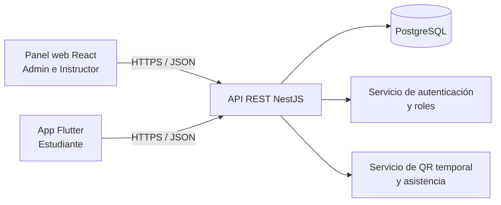
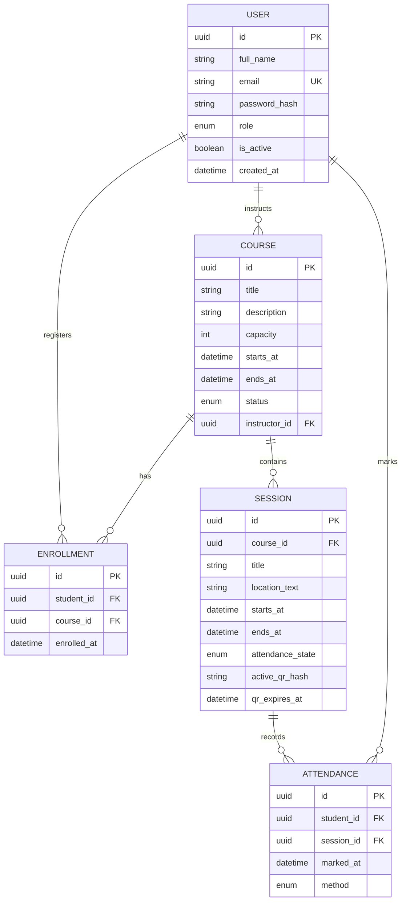
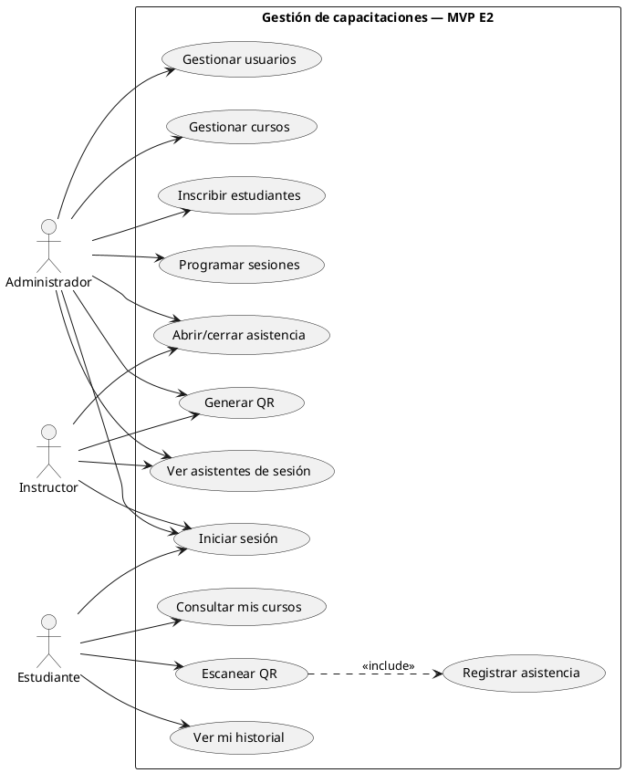
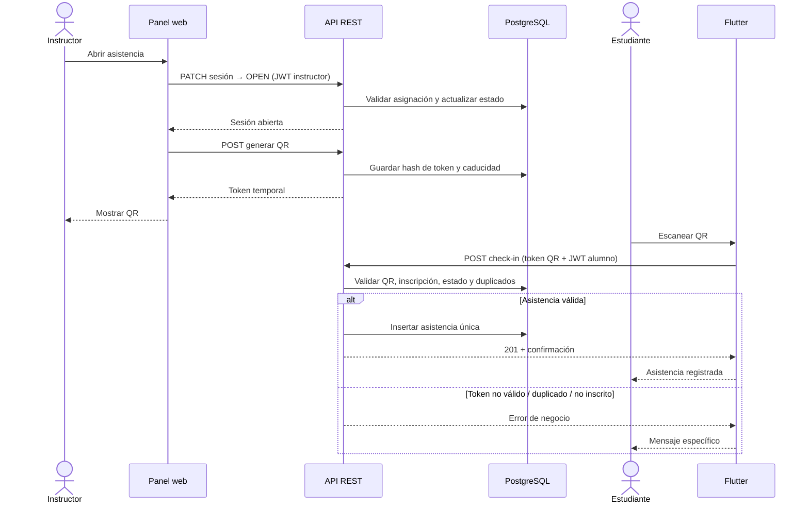
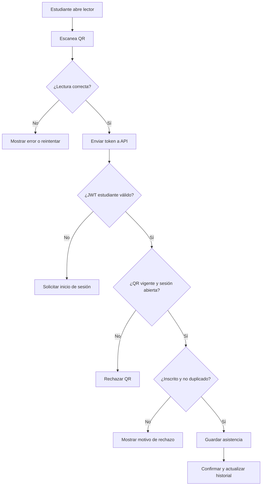
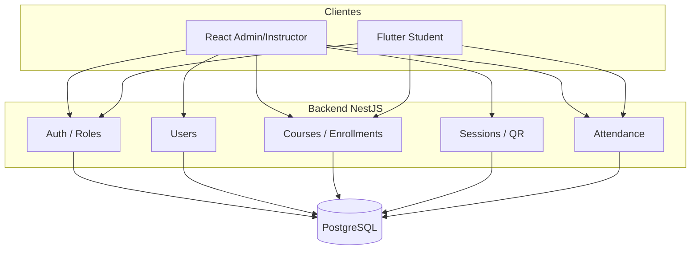

# Especificaciones maestras — Sistema Web y Móvil de Gestión de Capacitaciones

**Proyecto del curso:** Diseño e Implementación de un Sistema Web y Móvil para la Gestión, Seguimiento e Impacto Sostenible de Capacitaciones  
**Asignatura:** Ingeniería de Software I  
**Documento:** Base de requisitos, Product Backlog y guía de construcción con GitHub Spec Kit  
**Versión:** 1.0 — propuesta inicial, pendiente de validación por el equipo  
**Horizonte de implementación:** Entregas N.° 1 (semana 2) y N.° 2 (semana 6)  
**Estado del proyecto:** Documento de planificación; NO acredita funcionalidades ya implementadas.

> **Cómo leer este archivo.** Las exigencias marcadas **[DOCENTE]** proceden del PDF del curso. Las decisiones **[PROPUESTA]** se plantean para obtener un producto demostrable en poco tiempo. Las funcionalidades **[POST-E2]** pertenecen al alcance global del proyecto, pero NO se desarrollarán para la segunda entrega salvo tiempo disponible. Este documento es la fuente inicial de verdad de requisitos; Jira registrará su seguimiento y Spec Kit generará especificaciones ejecutables por funcionalidad.

---

## 0. Decisión de alcance y estrategia

**[DOCENTE] Entrega 1, semana 2:** Capítulo I; bosquejo del Capítulo II; Product Backlog inicial priorizado en Jira/Trello; Definition of Done (DoD) con aspectos éticos y legales de protección de datos personales.

**[DOCENTE] Entrega 2, semana 6:** Capítulos I y II mejorados; bosquejo del Capítulo III; sistema funcionando al menos al 50 %, **expresamente con autenticación, gestión de cursos/usuarios y aplicación móvil con marcado de asistencia mediante QR**.

**[PROPUESTA] Entregar un único sistema cliente-servidor con dos interfaces:**

1. **Panel web administrativo e instructor:** inicia sesión; administra usuarios/cursos; asigna instructores e inscripciones; programa sesiones; abre asistencia y muestra un QR dinámico.
2. **Aplicación Flutter para capacitandos:** inicia sesión; consulta sus capacitaciones; escanea QR con la cámara; registra una sola asistencia válida; consulta su historial.
3. **Backend compartido:** implementa reglas, autorización, generación/validación de QR y persistencia en PostgreSQL. **No** se crearán dos backends ni dos bases de datos.

**Meta de demostración E2:** un administrador crea un instructor y un estudiante, crea un curso, inscribe al estudiante, crea una sesión y asigna al instructor; el instructor abre el registro y muestra un QR; el estudiante inicia sesión en Flutter, lo escanea y el sistema guarda y presenta la asistencia; un segundo intento se rechaza como duplicado.

**No desarrollar por ahora:** blockchain, certificados digitales firmados, evaluaciones automáticas, dashboards de impacto sostenible, notificaciones push, geolocalización, módulos interactivos y arquitectura de microservicios. Son parte del backlog futuro, no del MVP E2.

**Nota sobre “50 %”:** el PDF no proporciona fórmula cuantitativa para medirlo. Este plan garantiza los tres componentes funcionales que **sí** enumera la Entrega 2; el porcentaje final deberá sustentarse con el backlog acordado, las historias terminadas y una demostración real. No afirmar “50 % implementado” sin medición o validación.

---

# CAPÍTULO I. DATOS GENERALES DEL PROYECTO

## 1.1. Título

**Diseño e Implementación de un Sistema Web y Móvil para la Gestión, Seguimiento e Impacto Sostenible de Capacitaciones.**

## 1.2. Objetivos

### Objetivo general [DOCENTE]

Diseñar e implementar una plataforma web y móvil integral para la gestión, seguimiento y evaluación del impacto de programas de capacitación profesional y comunitaria, optimizando la asignación de instructores, el control de asistencia, la emisión automatizada de certificados digitales y la medición del desarrollo sostenible mediante la metodología ágil SCRUM.

### Objetivos específicos [DOCENTE]

1. Gestionar eficientemente cursos, instructores, participantes y zonas/sedes de capacitación en el ámbito local (Cusco) y regional.
2. Implementar un módulo de seguimiento en tiempo real y asistencia geolocalizada mediante aplicación móvil.
3. Automatizar la evaluación continuada y la generación transparente de certificados verificables con código QR/Blockchain.
4. Proveer un dashboard analítico para medir el cumplimiento de capacitación y su impacto social, económico y ambiental.

**Descomposición para Entrega 2 [PROPUESTA]:** se trabaja principalmente el objetivo específico 1 y una parte del 2 (**asistencia QR**, todavía sin geolocalización). Los objetivos 3 y 4 permanecen documentados para fases posteriores. No confundir el cumplimiento parcial del proyecto con el cumplimiento total de todos los objetivos específicos.

## 1.3. Alcance [DOCENTE + propuesta de etapas]

**Alcance global:** gestión integral del ciclo de capacitación: oferta formativa, registro, administración de sedes/participantes/instructores, control móvil de asistencia, evaluaciones, certificados y reportes de impacto.

**Alcance implementable E2:** autenticación y roles, administración básica de usuarios, cursos y sesiones, inscripciones por administrador, consulta de cursos por estudiante, apertura de asistencia con QR dinámico, escaneo móvil, validación y consulta de registros.

**Limitaciones E2:** versión Android probada mediante emulador/dispositivo; soporte iOS como posibilidad de Flutter sin obligación de despliegue; sin firma digital ni blockchain; sin geolocalización; sin servicio de mensajería; sin analítica avanzada.

## 1.4. Justificación [DOCENTE, síntesis fiel]

La gestión manual de capacitaciones mediante hojas de cálculo y formatos físicos dificulta la trazabilidad de participantes y asistencia, expone los certificados a falsificación y limita el seguimiento de resultados. Un sistema unificado de gestión web y registro móvil propone mayor control, transparencia y disponibilidad de la información de capacitación en el contexto local y regional.

## 1.5. Stack tecnológico [PROPUESTA: selección, no obligación del docente]

| Capa | Tecnología | Motivo |
|---|---|---|
| Móvil | Flutter + Dart | Entorno actual del equipo; Android con VS Code y emulador de Android Studio. |
| Web | React + TypeScript + Vite | Panel administrativo sencillo y rápido de implementar. |
| Backend | Node.js + TypeScript + NestJS | API REST, guardias de roles y organización modular. |
| Datos | PostgreSQL | Relaciones y restricciones de integridad importantes para cursos y asistencias. |
| Acceso a datos | Prisma ORM | Esquema, migraciones y consultas tipadas. |
| Autenticación | JWT de acceso + contraseñas con hash | Un inicio de sesión común para Flutter y Web. |
| QR | Token efímero emitido/validado por el servidor; biblioteca QR en web y escáner móvil | Evitar depender de QR estáticos o de identificadores adivinables. |
| Desarrollo | VS Code, Flutter SDK, Android Studio (emulador), GitHub, Spec Kit + `agy` | Se conserva el entorno existente. |
| Gestión y diseño | Jira o Trello; Figma opcional | Evidencia de Scrum y bocetos mínimos. |

**Simplificación permitida:** si el equipo ya dispone de un backend funcional distinto, conservarlo y registrar el cambio técnico sin alterar los requisitos. No agregar MongoDB exclusivamente porque aparece como alternativa en el enunciado; no es necesario para el MVP transaccional.

## 1.6. Equipo y roles Scrum [DOCENTE]

| Rol | Función | Responsable |
|---|---|---|
| Product Owner | Priorizar Product Backlog, definir valor y aceptar historias. | Por asignar |
| Scrum Master | Facilitar reuniones, gestionar impedimentos y verificar DoD. | Por asignar |
| Developer 1 (Fullstack / Backend) | API REST, lógica de negocio, seguridad, base de datos. | Por asignar |
| Developer 2 (Mobile / Frontend) | Flutter, integración móvil y panel web. | Por asignar |

**Nota:** son cuatro roles para cuatro integrantes, de acuerdo con el PDF; la implementación de tareas puede ser colaborativa. No inventar nombres ni reuniones realizadas.

## 1.7. Público objetivo [DOCENTE]

- **Administrador/coordinador:** planifica cursos, gestiona recursos, usuarios y registros.
- **Instructor/ponente:** desarrolla sesiones y supervisa asistencia.
- **Estudiante/capacitando:** consulta su formación y marca asistencia.

---

# CAPÍTULO II. MÉTODO SCRUM APLICADO

## 2.1. Contexto funcional y límites

### 2.1.1. Módulos del enunciado

| Módulo | Alcance de largo plazo [DOCENTE] | Recorte E2 [PROPUESTA] |
|---|---|---|
| M1. Usuarios, roles y zonas/sedes | Registro, roles, zonas, facultades y asignaciones. | Usuarios y roles; sede como texto de referencia en sesión. Catálogo avanzado de sedes después. |
| M2. Catálogo y materiales | Cursos, temarios, materiales, competencias. | Cursos y asignación de instructor; archivos y competencias después. |
| M3. Monitoreo, asistencia y geolocalización | QR dinámico o geolocalización, monitoreo en tiempo real. | QR dinámico, registros de asistencia y listado actualizado; geolocalización después. |
| M4. Aplicación móvil | Inscripciones, notificaciones, certificados, materiales. | Inicio de sesión, «mis cursos», escaneo y «mis asistencias». |
| M5. Evaluación, certificados y alertas | Exámenes, alertas, certificados PDF verificables. | Solo modelado futuro. |
| M6. Analítica e impacto sostenible | Avance, aprobación e indicadores sociales, económicos, ambientales. | Solo modelado futuro. |

### 2.1.2. Reglas de dominio y definiciones

- **Usuario:** persona con credenciales y un único rol para el MVP (`ADMIN`, `INSTRUCTOR`, `STUDENT`).
- **Curso:** oferta formativa gestionada por el administrador; tiene título, descripción, cupo, fechas y un instructor asignado.
- **Inscripción:** relación entre estudiante y curso; el estudiante debe estar inscrito para marcar asistencia.
- **Sesión:** evento concreto de un curso con fecha, hora, ubicación textual y estado de asistencia.
- **Asistencia:** registro único de un estudiante en una sesión, asociado a fecha/hora de validación del servidor.
- **QR dinámico:** representación de un **token temporal** de la sesión, no un QR con datos personales ni un código permanente.

**Decisiones operativas que el equipo puede revisar:** el administrador crea cuentas e inscribe estudiantes (no hay registro público E2); solo el instructor asignado al curso y el administrador pueden abrir el QR; un curso tiene un instructor principal E2; una sesión admite un registro de asistencia por estudiante; el servidor determina la hora válida.

## 2.2. Requisitos funcionales (RF)

**Convención:** `P0` = indispensable para E2; `P1` = importante si queda tiempo; `P2` = pospuesto. `WEB`, `APP`, `API` indican interfaces responsables; un RF puede cruzarlas.

| ID | Requisito verificable | Actor/superficie | Prioridad | HU |
|---|---|---|---|---|
| RF-01 | Autenticar con correo y contraseña y emitir sesión/token válido. | Todos / WEB, APP, API | P0 | HU-01 |
| RF-02 | Restringir rutas y operaciones según rol. | Todos / WEB, APP, API | P0 | HU-02 |
| RF-03 | Consultar perfil autenticado y cerrar sesión. | Todos / WEB, APP | P0 | HU-01 |
| RF-04 | Crear usuarios con nombre, correo, rol y contraseña inicial. | Admin / WEB, API | P0 | HU-03 |
| RF-05 | Listar, buscar por correo/nombre, editar y desactivar usuarios. | Admin / WEB, API | P0 | HU-04 |
| RF-06 | Crear, listar, consultar y editar cursos. | Admin / WEB, API | P0 | HU-05 |
| RF-07 | Asignar un instructor existente a un curso. | Admin / WEB, API | P0 | HU-06 |
| RF-08 | Inscribir un estudiante existente en un curso. | Admin / WEB, API | P0 | HU-07 |
| RF-09 | Programar una sesión dentro de un curso. | Admin / WEB, API | P0 | HU-08 |
| RF-10 | Mostrar al estudiante sus cursos inscritos. | Estudiante / APP, API | P0 | HU-09 |
| RF-11 | Permitir al instructor abrir/cerrar el periodo de asistencia de una sesión. | Instructor/Admin / WEB, API | P0 | HU-10 |
| RF-12 | Generar un QR temporal para una sesión de asistencia abierta. | Instructor/Admin / WEB, API | P0 | HU-11 |
| RF-13 | Leer el QR con cámara del dispositivo desde Flutter. | Estudiante / APP | P0 | HU-12 |
| RF-14 | Validar token, periodo activo, inscripción y duplicados antes de guardar asistencia. | API | P0 | HU-13 |
| RF-15 | Mostrar al estudiante resultado del marcado y su historial de asistencia. | Estudiante / APP, API | P0 | HU-14 |
| RF-16 | Consultar en web el listado de asistencias de una sesión. | Admin/Instructor / WEB, API | P0 | HU-15 |
| RF-17 | Gestionar un catálogo independiente de zonas, sedes y facultades. | Admin / WEB | P2 | HU-16 |
| RF-18 | Publicar temarios, categorías, materiales descargables e interactivos. | Admin/Estudiante / WEB, APP | P2 | HU-17 |
| RF-19 | Gestionar autoinscripciones y notificaciones de inicio de clase. | Estudiante / APP | P2 | HU-18 |
| RF-20 | Incorporar validación geolocalizada de presencia con tratamiento legítimo de ubicación. | Estudiante / APP, API | P2 | HU-19 |
| RF-21 | Crear evaluaciones y registrar resultados/notas. | Instructor/Estudiante / WEB, APP | P2 | HU-20 |
| RF-22 | Generar certificados PDF con verificación QR; estudiar firma digital y blockchain. | Admin/Estudiante / WEB, APP | P2 | HU-21 |
| RF-23 | Emitir alertas de inasistencia. | Sistema/usuarios / WEB, APP | P2 | HU-22 |
| RF-24 | Mostrar indicadores de avance, aprobación e impacto social/ambiental. | Admin / WEB | P2 | HU-23 |

**Límite:** RF-17 a RF-24 se conservan en el Product Backlog porque son parte del proyecto completo, pero no forman parte del compromiso de construcción hasta E2.

## 2.3. Requisitos no funcionales (RNF)

| ID | Requisito / criterio comprobable | Evidencia esperada | Prioridad |
|---|---|---|---|
| RNF-01 | La API validará los datos y hará cumplir permisos en servidor, no solo ocultando botones. | Pruebas `401/403/422` o `400`. | P0 |
| RNF-02 | Las contraseñas se almacenarán con un algoritmo de hash adecuado (Argon2 o bcrypt) y jamás en texto plano. | Revisión de esquema y código. | P0 |
| RNF-03 | El QR tendrá vencimiento corto (propuesta: 60 s), podrá renovarse y su validez se verificará en servidor. | Prueba de QR vencido. | P0 |
| RNF-04 | Debe impedirse un segundo marcado de la misma persona y sesión, incluso con solicitudes simultáneas. | Restricción única BD + prueba de duplicado. | P0 |
| RNF-05 | Mantener consistencia de interfaz, validación y mensajes comprensibles; estados de carga/error/vacío. | Capturas y prueba manual. | P0 |
| RNF-06 | Utilizar HTTPS cuando se despliegue; en desarrollo local documentar excepciones de red/emulador. | Configuración y README. | P0 |
| RNF-07 | Registrar solo datos necesarios para operación; proteger información personal según LPDP. | Aviso informativo y revisión de campos/logs. | P0 |
| RNF-08 | La app debe ejecutar en Android y comunicarse con el backend usando URL configurable. | Prueba con emulador o dispositivo. | P0 |
| RNF-09 | Organizar código por módulos, con variables de entorno y sin secretos en Git. | Revisión de repositorio. | P0 |
| RNF-10 | Contar con pruebas mínimas de autenticación, permisos, inscripción y asistencia; Flutter sin errores de análisis. | Salidas `flutter analyze`, tests backend. | P0 |
| RNF-11 | Como objetivo de rendimiento de desarrollo, las operaciones usuales deberían responder en menos de 3 s en entorno local estable con pocos usuarios. | Medición manual, no SLA garantizado. | P1 |
| RNF-12 | Mantener legibilidad/accesibilidad básica (tamaños, contraste, etiquetas y mensajes). | Revisión visual básica. | P1 |
| RNF-13 | Centralizar tiempos en UTC en servidor y presentar hora local al usuario. | Prueba horario Cusco/Lima (UTC-5). | P1 |

## 2.4. Reglas de negocio (RN)

| ID | Regla |
|---|---|
| RN-01 | El correo de cada usuario es único, normalizado (sin espacios extremos y en minúsculas). |
| RN-02 | Solo administradores pueden crear/desactivar usuarios, crear cursos e inscribir participantes. |
| RN-03 | El instructor solo administra la asistencia de sesiones de cursos asignados; el admin puede supervisarlas. |
| RN-04 | No se inscribirá dos veces el mismo estudiante a un curso (clave única `student_id + course_id`). |
| RN-05 | Solo usuarios activos e inscritos pueden marcar asistencia del curso correspondiente. |
| RN-06 | Un QR pertenece a una sesión y caduca; no sirve para otra sesión ni después del cierre. |
| RN-07 | Solo sesiones con asistencia `OPEN` aceptan marcados; la hora de validez se obtiene del backend. |
| RN-08 | Una asistencia aceptada es única por `session_id + student_id`, sin importar cuántas veces se escanee el QR. |
| RN-09 | El token QR no debe contener nombre, DNI, correo u otros datos personales del estudiante. |
| RN-10 | Cuando se cierre la asistencia, los QR existentes dejan de ser válidos. |
| RN-11 | No se puede asignar como instructor a un usuario con rol diferente de `INSTRUCTOR`. |
| RN-12 | El cupo del curso no debe superarse al registrar inscripciones; la desactivación de usuarios conserva el historial. |
| RN-13 | Una sesión tiene fecha de inicio anterior a su fecha de fin. |
| RN-14 | La eliminación física de usuarios, cursos y asistencias con historial no se incluye en E2: usar desactivación/estado y mantener integridad. |
| RN-15 | La lectura repetida de un QR no debe producir registros adicionales ni resultados ambiguos. |

## 2.5. Product Backlog priorizado — listo para transcribir a Jira

**Tipos:** EP = épica; HU = historia de usuario. **Puntos de historia (SP)** son estimaciones iniciales relativas (Fibonacci), NO horas ni porcentaje de cumplimiento. Deben validarse por el equipo en Sprint Planning. **E2** = incluido en entrega 2; **POST** = después.

| Orden | Épica | ID | Historia resumida | P | SP estim. | Sprint propuesto | Hito |
|---:|---|---|---|---|---:|---|---|
| 1 | EP-01 Acceso y roles | HU-01 | Iniciar y cerrar sesión, consultar perfil. | P0 | 5 | S2 | E2 |
| 2 | EP-01 Acceso y roles | HU-02 | Controlar permisos por rol. | P0 | 5 | S2 | E2 |
| 3 | EP-02 Gestión web | HU-03 | Crear cuentas de usuario. | P0 | 3 | S2 | E2 |
| 4 | EP-02 Gestión web | HU-04 | Listar, editar y desactivar usuarios. | P0 | 5 | S2 | E2 |
| 5 | EP-02 Gestión web | HU-05 | Crear, listar, consultar y editar cursos. | P0 | 5 | S2 | E2 |
| 6 | EP-02 Gestión web | HU-06 | Asignar instructor a curso. | P0 | 2 | S2 | E2 |
| 7 | EP-02 Gestión web | HU-07 | Inscribir estudiante a curso. | P0 | 3 | S2 | E2 |
| 8 | EP-03 Sesiones y QR | HU-08 | Programar sesión de curso. | P0 | 3 | S3 | E2 |
| 9 | EP-04 Flutter estudiante | HU-09 | Consultar mis capacitaciones. | P0 | 3 | S3 | E2 |
| 10 | EP-03 Sesiones y QR | HU-10 | Abrir/cerrar asistencia de sesión. | P0 | 3 | S3 | E2 |
| 11 | EP-03 Sesiones y QR | HU-11 | Mostrar QR dinámico desde web. | P0 | 5 | S3 | E2 |
| 12 | EP-04 Flutter estudiante | HU-12 | Escanear QR desde Flutter. | P0 | 5 | S3 | E2 |
| 13 | EP-03 Sesiones y QR | HU-13 | Validar y almacenar asistencia única. | P0 | 8 | S3 | E2 |
| 14 | EP-04 Flutter estudiante | HU-14 | Mostrar confirmación e historial propio. | P0 | 3 | S3 | E2 |
| 15 | EP-03 Sesiones y QR | HU-15 | Consultar asistencias de una sesión en web. | P0 | 3 | S3 | E2 |
| 16 | EP-05 Extensiones formativas | HU-16 | Gestionar sedes, zonas y facultades. | P2 | 3 | Futuro | POST |
| 17 | EP-05 Extensiones formativas | HU-17 | Publicar temarios, materiales y categorías. | P2 | 5 | Futuro | POST |
| 18 | EP-05 Extensiones formativas | HU-18 | Autoservicio de inscripción y notificaciones. | P2 | 8 | Futuro | POST |
| 19 | EP-05 Extensiones formativas | HU-19 | Geolocalizar y validar asistencia. | P2 | 8 | Futuro | POST |
| 20 | EP-06 Evaluación/certificación | HU-20 | Registrar evaluaciones y notas. | P2 | 8 | Futuro | POST |
| 21 | EP-06 Evaluación/certificación | HU-21 | Certificados PDF y verificación QR. | P2 | 8 | Futuro | POST |
| 22 | EP-06 Evaluación/certificación | HU-22 | Alertas de inasistencia. | P2 | 5 | Futuro | POST |
| 23 | EP-07 Impacto sostenible | HU-23 | Dashboard de avance e impacto. | P2 | 13 | Futuro | POST |

**Referente de planificación:** las 15 historias E2 suman **61 SP estimados**, frente a **58 SP estimados** del backlog posterior (119 SP en total); equivalen a ≈51 % de los SP iniciales. **Esto NO demuestra por sí mismo un 51 % del sistema**: los SP miden esfuerzo relativo y la aceptación E2 exige flujo real, pruebas y revisión del docente. La suma solo ofrece una forma transparente de explicar el recorte inicial.

**Dependencias:** HU-01/02 → HU-03 a HU-08; HU-05/06/07/08 → HU-10/11/13; HU-01/07/09 → HU-12/13/14; HU-13 → HU-15. Para marcar asistencia, el flujo vertical completo importa más que agregar pantallas decorativas.

### 2.5.1. Historias E2, formato implementable con criterios de aceptación

**HU-01 — Autenticación y perfil**  
Como **usuario**, quiero iniciar y cerrar sesión para acceder a las funciones asociadas a mi rol.  
**CA:** (1) Credenciales válidas devuelven token y perfil; (2) credenciales inválidas muestran error sin revelar si el correo existe; (3) cerrar sesión elimina credenciales locales y bloquea pantallas privadas; (4) un usuario inactivo no accede; (5) el token vencido obliga a iniciar sesión nuevamente.  
**RF:** RF-01, RF-03. **Evidencia:** login web/móvil y respuestas `200/401`.

**HU-02 — Autorización por roles**  
Como **administrador**, quiero permisos diferenciados para impedir operaciones no autorizadas.  
**CA:** (1) Admin accede a gestión; (2) instructor accede solo a cursos asignados y a la asistencia pertinente; (3) estudiante solo consulta sus propios datos; (4) una llamada directa no autorizada a API devuelve `403`.  
**RF:** RF-02. **Evidencia:** matriz de pruebas por rol.

**HU-03 — Crear usuarios**  
Como **administrador**, quiero registrar usuarios de distintos roles para habilitarles acceso al sistema.  
**CA:** (1) El formulario exige nombre, correo, rol y contraseña inicial segura; (2) rechaza correo duplicado y rol inválido; (3) el usuario creado puede iniciar sesión; (4) la contraseña no se guarda en texto claro.  
**RF:** RF-04. **Evidencia:** creación y login del usuario nuevo.

**HU-04 — Gestionar usuarios**  
Como **administrador**, quiero listar, consultar, editar y desactivar usuarios para mantener el padrón vigente.  
**CA:** (1) Se muestra lista con nombre, correo, rol y estado; (2) se puede actualizar nombre/rol y estado conforme a restricciones; (3) usuarios desactivados no acceden; (4) desactivar no borra sus asistencias históricas.  
**RF:** RF-05. **Evidencia:** actualización en web y base de datos.

**HU-05 — Gestionar cursos**  
Como **administrador**, quiero crear y actualizar cursos para publicar la oferta de capacitación.  
**CA:** (1) Se solicitan título, descripción breve, fecha de inicio/fin, cupo y estado; (2) fechas válidas y cupo mayor que cero; (3) se listan los cursos creados y se puede consultar uno; (4) se puede editar sin corromper inscripciones existentes.  
**RF:** RF-06. **Evidencia:** CRUD básico funcionando.

**HU-06 — Asignar instructor**  
Como **administrador**, quiero asignar un instructor a un curso para establecer quién dicta sus sesiones.  
**CA:** (1) Solo aparecen usuarios activos con rol Instructor; (2) el curso muestra al instructor asignado; (3) un instructor distinto no puede generar el QR de ese curso.  
**RF:** RF-07. **Evidencia:** asignación y autorización.

**HU-07 — Inscribir estudiante**  
Como **administrador**, quiero inscribir estudiantes a cursos para controlar quién puede asistir.  
**CA:** (1) Solo estudiantes activos; (2) no se repite inscripción; (3) no se supera el cupo; (4) el curso aparece en «Mis cursos» del alumno.  
**RF:** RF-08. **Evidencia:** inscripción web visible en app.

**HU-08 — Programar sesión**  
Como **administrador**, quiero crear sesiones para definir días y horarios de asistencia.  
**CA:** (1) Cada sesión pertenece a un curso; (2) registra título, fecha/hora de inicio y fin, y ubicación textual; (3) no admite fin anterior o igual al inicio; (4) la sesión aparece en el detalle del curso.  
**RF:** RF-09. **Evidencia:** creación de sesión y visualización.

**HU-09 — Consultar mis cursos**  
Como **estudiante**, quiero ver mis cursos inscritos para conocer mi capacitación.  
**CA:** (1) Ve únicamente cursos donde está inscrito; (2) cada curso presenta nombre, fechas e instructor; (3) puede entrar a detalle y ver sesiones; (4) hay mensajes de vacío y de error de conexión.  
**RF:** RF-10. **Evidencia:** cuenta estudiante con datos de prueba.

**HU-10 — Abrir/cerrar asistencia**  
Como **instructor asignado**, quiero controlar cuándo puede marcarse la asistencia para evitar registros fuera de sesión.  
**CA:** (1) Puede abrir el registro desde su curso/sesión; (2) se visualiza estado `OPEN/CLOSED`; (3) al cerrar, ninguna solicitud nueva de QR es aceptada; (4) instructor ajeno no puede abrir/cerrar.  
**RF:** RF-11. **Evidencia:** cambio de estado y prueba API.

**HU-11 — Mostrar QR dinámico**  
Como **instructor**, quiero mostrar un QR de corta duración para que los estudiantes registren asistencia presencial.  
**CA:** (1) La web solicita un token temporal al backend; (2) el QR se renueva, como referencia, cada 60 segundos mientras la asistencia esté abierta; (3) un QR vencido se rechaza; (4) el QR no incluye datos del estudiante; (5) al cerrar, el QR deja de mostrarse y funcionar.  
**RF:** RF-12. **Evidencia:** QR en pantalla + prueba de expiración.

**HU-12 — Escanear QR móvil**  
Como **estudiante**, quiero escanear el QR de una sesión con mi dispositivo para registrar mi asistencia.  
**CA:** (1) Solicita permiso de cámara cuando corresponde; (2) interpreta el formato de QR esperado; (3) envía el token al backend con la sesión autenticada; (4) muestra mensajes de éxito, expiración y error de cámara; (5) no registra asistencias ficticias si no hay conectividad.  
**RF:** RF-13. **Evidencia:** video o captura de escaneo efectivo.

**HU-13 — Validar y persistir asistencia**  
Como **sistema**, quiero validar el QR, la sesión y la inscripción para guardar asistencias correctas.  
**CA:** (1) Solo se admite token vigente emitido por el backend; (2) sesión abierta; (3) usuario estudiante, activo e inscrito; (4) solo una fila por estudiante/sesión; (5) duplicados devuelven respuesta diferenciada sin crear otra fila; (6) instructor ajeno, QR de otra sesión o token manipulado se rechazan.  
**RF:** RF-14. **Evidencia:** tabla con una fila y pruebas negativas.

**HU-14 — Confirmación e historial**  
Como **estudiante**, quiero confirmar mi marcado y revisar mis asistencias para verificar que quedaron registradas.  
**CA:** (1) Tras éxito, se muestra curso, sesión y hora registrada; (2) historial incluye únicamente sus registros; (3) si intenta duplicar, aparece «asistencia ya registrada»; (4) un error no se presenta como éxito.  
**RF:** RF-15. **Evidencia:** captura móvil antes y después.

**HU-15 — Consulta web de asistencias**  
Como **instructor/administrador**, quiero ver estudiantes asistentes por sesión para llevar control.  
**CA:** (1) Lista alumnos con estado de asistencia y hora; (2) solo instructor asignado o admin accede; (3) el registro aparece después de la confirmación móvil, mediante recarga/actualización manual; (4) sin duplicados.  
**RF:** RF-16. **Evidencia:** misma asistencia visible web y móvil.

### 2.5.2. Historias POST-E2 — conservar, no ejecutar aún

| HU | Historia abreviada y aceptación futura mínima |
|---|---|
| HU-16 | Como admin gestiono sedes/zonas; cada sede tiene identificación y cursos vinculados. |
| HU-17 | Como instructor/admin publico materiales; estudiante inscrito puede consultarlos. |
| HU-18 | Como estudiante me inscribo según cupos y recibo aviso de una próxima clase. |
| HU-19 | Como estudiante marco asistencia con verificación geográfica consentida y minimizada. |
| HU-20 | Como instructor creo evaluaciones y califico; alumno ve su resultado. |
| HU-21 | Como estudiante descargo certificado PDF cuya autenticidad puede verificarse mediante QR; explorar firmas y blockchain según viabilidad. |
| HU-22 | Como usuario recibo alerta relevante ante inasistencias. |
| HU-23 | Como admin veo indicadores de finalización, aprobación, inclusión e impacto sostenible sustentados en datos. |

## 2.6. Matriz de permisos E2

**S** = sí; **A** = solo asignaciones/recursos propios; **N** = no.

| Acción | Admin | Instructor | Estudiante |
|---|:---:|:---:|:---:|
| Iniciar sesión / ver perfil | S | S | S |
| Crear/editar usuarios | S | N | N |
| Crear/editar cursos | S | N | N |
| Asignar instructor | S | N | N |
| Inscribir estudiantes | S | N | N |
| Crear sesiones | S | N | N |
| Consultar cursos del sistema | S | A | A (inscritos) |
| Abrir/cerrar QR de sesión | S | A | N |
| Consultar asistencias de sesión | S | A | N |
| Escanear QR y marcar asistencia | N | N | S (solo si inscrito) |
| Consultar historial propio | N | N | S |

**Implementar permisos en el backend, incluso si la interfaz oculta las acciones.**

## 2.7. Planeamiento de sprints

**[PROPUESTA] Tres sprints de dos semanas cada uno.** Los sprints, horas y responsables deben ser confirmados por el grupo antes de presentar evidencia formal.

| Sprint | Semanas | Objetivo y trabajo comprometido | Resultado verificable |
|---|---|---|---|
| S1 | 1–2 | Leer enunciado, delimitar MVP, Cap. I, backlog, RF/RNF, DoD, wireframes básicos, arquitectura preliminar, Jira/Trello. | **Entrega 1:** documentación y tablero inicial, no se exige software completo. |
| S2 | 3–4 | Backend, base de datos, autenticación, roles, administración web de usuarios/cursos e inscripciones. | Admin inicia sesión y administra usuarios, cursos e inscripciones. |
| S3 | 5–6 | Sesiones, QR dinámico web, escaneo y asistencia Flutter, integración, pruebas, capturas, Cap. II mejorado y bosquejo Cap. III. | **Entrega 2:** recorrido de asistencia real de extremo a extremo. |

### 2.7.1. Planning de S1 (a registrar, no afirmar como hecho)

- Product Backlog revisado por Product Owner.
- Acuerdo de términos: curso / sesión / inscripción / asistencia.
- Selección y justificación de stack y arquitectura cliente-servidor.
- Definición de DoD, riesgos y datos personales.
- Creación del tablero Jira/Trello y repositorio GitHub.
- Preparar Capítulo I y bosquejo de II.

### 2.7.2. Planning de S2

- HU-01 a HU-07: backend (migraciones/modelos/endpoints), panel web (formularios/listados), test de roles e inscripciones.
- Datos seed: 1 admin, 1 instructor, 2 estudiantes, 1 curso de ejemplo.
- Revisión al cierre: mostrar usuario nuevo e inscripción reflejada en PostgreSQL.

### 2.7.3. Planning de S3

- HU-08 a HU-15: sesiones, apertura/cierre, QR efímero, Flutter: login, mis cursos, escaneo, asistencia e historial.
- Pruebas críticas: QR caducado, duplicado, no inscrito, instructor ajeno, falta de red y sesión cerrada.
- Integración web/API/Flutter; capturas y video de flujo.

## 2.8. Herramientas de colaboración

- **GitHub:** historial de código, ramas/PR cuando corresponda, README e incidencias.
- **Spec Kit con Antigravity CLI (`agy`):** especificaciones, planificación, tareas e implementación por funcionalidad.
- **Jira (o Trello):** épicas, historias, estimación, prioridad, Sprint Backlog y estados reales.
- **Figma:** bocetos de pantallas si el equipo decide usarlo; alternativa válida: esquemas simples versionados como imágenes.
- **Discord/Slack/Meet:** coordinación y evidencias reales de acuerdos.

No declarar una herramienta como «utilizada» hasta que el grupo la use efectivamente; en el informe inicial puede presentarse como «prevista».

## 2.9. Definition of Done (DoD) — técnica, funcional, ética y legal

Una historia pasa a **Done** solo cuando se cumplen TODOS los puntos que correspondan:

- [ ] Cumple sus criterios de aceptación y fue revisada por alguien distinto de quien la implementó o validada por el responsable acordado.
- [ ] Está integrada al repositorio, sin credenciales ni secretos hardcodeados.
- [ ] La API valida entrada y permisos; no expone datos de otros usuarios.
- [ ] Incluye estados de error, carga y éxito pertinentes.
- [ ] Hay pruebas de flujo feliz y al menos un caso negativo de la historia.
- [ ] No introduce errores conocidos en `flutter analyze` ni en las pruebas definidas del backend.
- [ ] Se probó en el entorno relevante (web y/o Flutter Android).
- [ ] La funcionalidad guarda/consulta datos reales en backend; no se presenta una pantalla estática o mock como sistema completo.
- [ ] Se actualizó historia/tareas y se archivó evidencia (captura, resultado de test, commit o video).
- [ ] **LPDP:** se recogen solo datos necesarios; se muestra información sobre finalidad y responsable del tratamiento según corresponda; se revisa la base legal aplicable; no se expone información personal en logs/QR.
- [ ] **Privacidad:** si usa cámara, solicita permisos necesarios y explica el propósito; en E2 no se recoge GPS; cualquier incorporación futura de ubicación requiere evaluación específica.
- [ ] El PO acepta la historia; si no hay revisión, queda «Review», no «Done».

**Marco normativo que debe revisarse:** Ley peruana N.° 29733 y su Reglamento aprobado por D. S. N.° 016-2024-JUS (vigente desde el 31 de marzo de 2025). La base legal y las obligaciones concretas dependen de quién trate datos, sus fines y contexto; no presumir que un checkbox por sí solo resuelve el cumplimiento. Fuentes: [ANPD — Ley 29733](https://www.gob.pe/institucion/anpd/normas-legales/2018427-29733-2011) y [ANPD — Reglamento](https://www.gob.pe/institucion/anpd/normas-legales/6554453-n-016-2024-jus).

---

# 3. ARQUITECTURA Y CONTRATO DEL MVP

## 3.1. Arquitectura propuesta



**Una sola fuente de datos:** la app no accede directamente a PostgreSQL. Todos los permisos y reglas del QR se evalúan en la API.

## 3.2. Organización recomendada del repositorio

Si Flutter **ya existe en la raíz**, no reorganizarlo arbitrariamente. Agregar API y web como carpetas independientes:

```text
capacitaciones/
├── lib/                 # Flutter actual
├── android/             # Flutter actual
├── test/                # Flutter actual
├── pubspec.yaml         # Flutter actual
├── admin-web/           # React + TS (NO usar /web, reservado en Flutter)
├── api/                 # NestJS + Prisma
├── docs/
│   └── ESPECIFICACIONES_MAESTRAS_E1_E2_CAPACITACIONES.md
├── .specify/            # Artefactos base de Spec Kit
├── .agents/skills/      # Skills de la integración agy
└── specs/               # Historias y planes derivados por Spec Kit
```

**Alternativa:** si ya existen repos separados, mantenerlos y documentar los enlaces; la arquitectura funcional no cambia. Para este trabajo, un monorepo simplifica coordinación y especificaciones.

## 3.3. Modelo conceptual de datos — MVP E2



**Restricciones indispensables:** `USER.email` único; `ENROLLMENT(student_id, course_id)` único; `ATTENDANCE(student_id, session_id)` único; FKs obligatorias; `capacity > 0`; fecha inicial menor que final; rol y estados controlados. `active_qr_hash` y `qr_expires_at` pueden estar en `SESSION` para un MVP de una sola ventana QR vigente por sesión; no guardar el token en claro. Con más escenarios, separar entidad `QrChallenge`.

**Datos de ejemplo para desarrollo (ficticios):** admin@demo.local, instructor@demo.local, alumno1@demo.local, alumno2@demo.local, curso «Introducción a la Gestión Ambiental» y sesión «Taller 1». Las contraseñas de demostración se definirán por variables de entorno o seed local, jamás se publicarán en el repositorio.

## 3.4. Contrato inicial de API REST

Prefijo sugerido: `/api/v1`. Respuestas JSON y cabecera `Authorization: Bearer <access_token>` para endpoints protegidos. Los paths son una **propuesta técnica inicial** y pueden refinarse en `/speckit-plan` sin modificar la intención de RF/HU.

| Método | Ruta | Rol autorizado | Acción / HU |
|---|---|---|---|
| POST | `/auth/login` | Público | Credenciales → token/perfil · HU-01 |
| GET | `/auth/me` | Todos autenticados | Perfil · HU-01 |
| GET | `/users` | Admin | Listar usuarios · HU-04 |
| POST | `/users` | Admin | Crear usuario · HU-03 |
| PATCH | `/users/:id` | Admin | Editar/desactivar · HU-04 |
| GET | `/courses` | Según rol | Cursos disponibles/autorizados · HU-05/09 |
| GET | `/courses/:id` | Según rol | Detalle autorizado · HU-05/09 |
| POST | `/courses` | Admin | Crear curso · HU-05 |
| PATCH | `/courses/:id` | Admin | Modificar/asignar instructor · HU-05/06 |
| POST | `/courses/:id/enrollments` | Admin | Inscripción · HU-07 |
| GET | `/me/courses` | Estudiante | Mis cursos · HU-09 |
| POST | `/courses/:id/sessions` | Admin | Programar sesión · HU-08 |
| GET | `/courses/:id/sessions` | Según rol | Sesiones del curso · HU-08/09 |
| PATCH | `/sessions/:id/attendance-state` | Admin/instructor asignado | OPEN/CLOSED · HU-10 |
| POST | `/sessions/:id/qr` | Admin/instructor asignado | Emitir token temporal · HU-11 |
| POST | `/attendance/check-in` | Estudiante | Validar QR, crear asistencia · HU-12/13 |
| GET | `/me/attendance` | Estudiante | Historial propio · HU-14 |
| GET | `/sessions/:id/attendance` | Admin/instructor asignado | Asistencias de sesión · HU-15 |

**Ejemplos de contrato** (ilustrativos; el agente deberá documentar esquemas y errores de forma consistente):

```http
POST /api/v1/auth/login
{"email":"alumno1@demo.local","password":"<valor_privado>"}

200 OK
{"accessToken":"<jwt>","user":{"id":"uuid","fullName":"Alumno Demo","email":"alumno1@demo.local","role":"STUDENT"}}
```

```http
POST /api/v1/sessions/SESSION_ID/qr
Authorization: Bearer <jwt_del_instructor>

200 OK
{"token":"<cadena_aleatoria_opaca>","expiresAt":"2026-11-17T16:01:00Z"}
```

```http
POST /api/v1/attendance/check-in
Authorization: Bearer <jwt_del_estudiante>
{"qrToken":"<cadena_aleatoria_opaca>"}

201 Created
{"attendanceId":"uuid","sessionId":"uuid","status":"PRESENT","markedAt":"2026-11-17T16:00:30Z"}
```

**Errores recomendados:** `400` entrada inválida; `401` autenticación ausente/incorrecta; `403` rol no autorizado/no inscrito; `404` recurso no encontrado o inaccesible; `409` inscripción o asistencia repetida; `410` QR vencido/cerrado (o `400` con código de error distinguible); `422` estado de negocio incompatible. Unificar formato, por ejemplo `{"code":"ATTENDANCE_ALREADY_REGISTERED","message":"Asistencia ya registrada"}`.

## 3.5. Reglas técnicas específicas del QR

1. Instructor autenticado abre asistencia (`OPEN`) para sesión de su curso.
2. Web llama al backend para emitir **token criptográficamente aleatorio**, ligado a esa sesión y a caducidad corta (referencia: **60 s**).
3. Backend guarda **hash** del token vigente y su expiración. Si se renueva, invalida el anterior.
4. Web lo representa en QR, sin datos personales y mostrando cuenta regresiva/estado.
5. Flutter solicita permiso de cámara, escanea el QR y envía token y JWT del **estudiante autenticado**.
6. API compara hash, vigencia y estado; comprueba usuario activo, rol estudiante e inscripción.
7. API inserta asistencia de forma atómica, protegida por índice único; devuelve confirmación o error específico.
8. Al cerrar la asistencia, el token deja de funcionar.

**Seguridad/realismo:** un QR efímero reduce reutilización, pero **no garantiza presencia física** frente a fotos/reenvíos mientras está vigente. La geolocalización o controles adicionales son futuros y requieren evaluación de privacidad. No presentar el QR E2 como prueba irrefutable de presencia.

## 3.6. Mapa mínimo de pantallas

| Producto | Pantalla / ruta referencial | Actor | Alcance |
|---|---|---|---|
| WEB | `/login` | Todos web | Autenticación. |
| WEB | `/dashboard` | Admin/Instructor | Inicio simple y accesos. No dashboard analítico E2. |
| WEB | `/usuarios` y formulario | Admin | Listar, crear, editar, desactivar. |
| WEB | `/cursos` y `/cursos/:id` | Admin/Instructor | Crear/editar, asignar instructor, ver sesiones e inscripciones. |
| WEB | `/cursos/:id/inscripciones` | Admin | Inscribir estudiantes. |
| WEB | `/sesiones/:id/asistencia` | Admin/Instructor asignado | Abrir/cerrar, QR, tabla de asistentes. |
| APP | `LoginScreen` | Estudiante | Autenticación. |
| APP | `MyCoursesScreen` | Estudiante | Cursos inscritos. |
| APP | `CourseDetailScreen` | Estudiante | Detalle y sesiones. |
| APP | `QrScannerScreen` | Estudiante | Cámara/escaneo. |
| APP | `AttendanceResultScreen` | Estudiante | Confirmación/error. |
| APP | `MyAttendanceScreen` | Estudiante | Historial propio. |

**Criterios UI:** pantallas simples, coherentes, sin animaciones innecesarias; formularios con validación; navegación por rol; estados vacíos; opción de salir; permisos de cámara solo cuando se abre escáner.

## 3.7. Conexión de Flutter al backend en Android

- Emulador Android estándar con backend en el PC: normalmente usar `http://10.0.2.2:PUERTO` en desarrollo, **no** `localhost` desde el emulador.
- Dispositivo físico: usar IP local accesible del PC con firewall y misma red, o URL HTTPS de desarrollo.
- React ejecutándose en el PC puede utilizar la dirección del backend correspondiente (`localhost` cuando aplica solo en navegador del PC).
- Definir la URL por entorno/configuración; nunca hardcodear credenciales.
- Si se necesita HTTP local para desarrollo, limitar la excepción explícitamente al entorno de depuración, sin usarla en producción.

---

# 4. DIAGRAMAS BASE PARA ESPECIFICACIONES E INFORME

> Son **diagramas propuestos**. Deben actualizarse según la implementación real antes de incluirlos como evidencia del Capítulo III. El PDF indica utilizar los UML aplicables en cada sprint; no exige inventar diagramas de funcionalidades no construidas.

## 4.1. Casos de uso principales (PlantUML)



## 4.2. Secuencia: marcado de asistencia QR



## 4.3. Actividad básica del registro



## 4.4. Diagrama de componentes



---

# 5. CRITERIOS DE PRUEBA Y DEMOSTRACIÓN DE ENTREGA 2

## 5.1. Casos de prueba mínimos

| CP | Escenario | Resultado esperado | RF/HU |
|---|---|---|---|
| CP-01 | Admin inicia sesión con datos válidos. | Acceso al panel y perfil. | RF-01 / HU-01 |
| CP-02 | Contraseña incorrecta. | Error y ninguna sesión válida. | RF-01 / HU-01 |
| CP-03 | Estudiante intenta crear curso vía API. | `403`, sin creación. | RF-02 / HU-02 |
| CP-04 | Crear usuario con correo existente. | Error, sin duplicado. | RF-04 / HU-03 |
| CP-05 | Admin crea curso, asigna instructor e inscribe alumno. | Operaciones persistidas y relaciones correctas. | RF-06/08 / HU-05/07 |
| CP-06 | El alumno abre «Mis cursos». | Solo muestra cursos inscritos. | RF-10 / HU-09 |
| CP-07 | Instructor abre sesión y genera QR. | QR temporal visible. | RF-11/12 / HU-10/11 |
| CP-08 | Alumno inscrito escanea QR vigente. | Confirmación y una asistencia en BD. | RF-13/14 / HU-12/13 |
| CP-09 | Mismo alumno reescanea. | Mensaje duplicado; sigue una fila. | RF-14 / HU-13 |
| CP-10 | Alumno no inscrito escanea. | Rechazo; sin fila. | RF-14 / HU-13 |
| CP-11 | QR vencido o sesión cerrada. | Rechazo; sin fila. | RF-12/14 / HU-11/13 |
| CP-12 | Instructor ajeno intenta abrir QR. | `403`. | RF-02/11 / HU-02/10 |
| CP-13 | Alumno revisa historial y docente consulta sesión. | Ambos ven el mismo registro; accesos restringidos. | RF-15/16 / HU-14/15 |
| CP-14 | Error de red al marcar. | No simular éxito; permitir reintento. | RNF-05 / HU-12 |

## 5.2. Guion de demostración (flujo vertical)

1. Mostrar login web de **admin** y creación/consulta de usuarios ficticios.
2. Crear curso y asignar instructor; inscribir estudiante.
3. Programar sesión y abrir vista de instructor.
4. Ingresar al panel como **instructor** y mostrar QR temporal de la sesión.
5. Ingresar en Flutter como **estudiante** y mostrar «Mis cursos».
6. Escanear QR real y mostrar confirmación.
7. Mostrar en web la fila de asistencia y en Flutter el historial.
8. Repetir escaneo para evidenciar rechazo de duplicados.
9. Si alcanza el tiempo de exposición, comprobar el rechazo de QR caducado.

**Sobre el emulador:** verificar anticipadamente si la cámara virtual permite enfocar el QR mostrado en otra pantalla. Si no, probar con teléfono real o mecanismo de cámara virtual verificable. Un botón que «marca asistencia» sin leer QR **no cumple** el escenario exigido.

## 5.3. Evidencias que hay que conservar

- Captura de tablero Jira/Trello: épicas, historias, prioridades y sprints.
- Captura o enlace del repositorio con commits y estructura de carpetas.
- Capturas de web: usuarios, cursos, sesión, QR y lista de asistentes.
- Capturas de Flutter: login, mis cursos, lector, confirmación e historial.
- Evidencia de `flutter analyze`, tests relevantes y errores correctamente rechazados.
- Diagramas revisados según implementación y notas de Sprint Review/Retrospective **realizadas**.
- Registro explícito de lo pendiente, limitaciones conocidas y diferencias entre planeado y ejecutado.

---

# 6. GUÍA OPERATIVA: CÓMO ALIMENTAR GITHUB SPEC KIT CON ESTE MARKDOWN

**Objetivo:** mantener este documento académico como referencia única, pero **NO pedir al agente que implemente todo el backlog de una vez**. Crear tres especificaciones incrementales: autenticación; gestión administrativa; sesiones/asistencia Flutter. El agente generará archivos propios `spec.md`, `plan.md` y `tasks.md` en `specs/`.

## 6.1. Preparación (terminal PowerShell de VS Code)

```powershell
# Desde la raíz del repositorio Flutter existente:
git status
# Guardar cambios con commit o stash ANTES de inicializar Spec Kit.
uv tool install specify-cli
specify init --here --force --integration agy
```

`--force` admite proyecto no vacío y puede sobrescribir archivos gestionados que colisionen. Revisar el `git diff` después. En el repositorio, copiar ESTE Markdown a `docs/ESPECIFICACIONES_MAESTRAS_E1_E2_CAPACITACIONES.md` y commitearlo. **No** mover `lib/`, `android/` ni `pubspec.yaml` sin una decisión consciente.

Luego abrir la raíz desde el entorno del agente (Antigravity CLI `agy`) y ejecutar habilidades en su chat. En la integración `agy` se invocan como `/speckit-constitution`, `/speckit-specify`, etc.; son comandos del **agente**, no de PowerShell.

**Fuentes oficiales:** [Spec Kit — Antigravity](https://github.github.io/spec-kit/integrations/agy.html), [Spec Kit — proyectos existentes](https://github.github.io/spec-kit/how-to/existing-projects.html), [Spec Kit — Quickstart](https://github.github.io/spec-kit/quickstart.html).

## 6.2. Constitución — ejecutar UNA vez

**Pegar en el chat del agente:**

```text
/speckit-constitution
Este repositorio implementa el sistema de capacitaciones descrito en
`docs/ESPECIFICACIONES_MAESTRAS_E1_E2_CAPACITACIONES.md`.
Reglas del proyecto:
1) Respetar requisitos RF, RN y criterios de aceptación priorizados para E2.
2) No ampliar el alcance a funcionalidades POST-E2 salvo aprobación explícita.
3) Conservar el proyecto Flutter ya existente y evitar reestructuraciones innecesarias.
4) Usar una API REST común, base de datos relacional y permisos aplicados en servidor.
5) No poner contraseñas en claro, secretos en Git ni datos personales dentro de QR.
6) QR temporal, validación de inscripción y protección de asistencia duplicada.
7) Código legible, modular, sin sobreingeniería, con validaciones y pruebas básicas.
8) No simular funcionalidades como terminadas: registrar evidencia verificable.
9) Evitar geolocalización, blockchain, certificados y dashboard de impacto en E2.
10) Antes de implementar, revisar cambios y mantener consistencia con HU y RF.
```

## 6.3. Feature 1 — Autenticación y roles (HU-01, HU-02)

**1. Especificar (qué y por qué; SIN stack):**

```text
/speckit-specify
Lee `docs/ESPECIFICACIONES_MAESTRAS_E1_E2_CAPACITACIONES.md`,
especialmente HU-01, HU-02, RF-01 a RF-03, matriz de permisos y DoD.
Especifica SOLO el inicio/cierre de sesión, perfil y autorización por roles
ADMIN, INSTRUCTOR y STUDENT. Incluye escenarios de éxito, denegación,
usuario desactivado y sesión expirada. NO implementes todavía ni incluyas
funcionalidades POST-E2. Conserva IDs de historia para la trazabilidad.
```

**2. Planificar (decisiones técnicas):**

```text
/speckit-plan
Implementar usando el Flutter existente, panel administrativo React/TypeScript
si la feature lo necesita, backend Node/NestJS y PostgreSQL/Prisma.
API REST compartida, JWT, hash de contraseña y controles por rol en servidor.
Reutilizar lo que ya exista en el repositorio. Evitar librerías innecesarias.
No reemplazar el proyecto Flutter ni crear varios backends.
```

**3. Ejecutar secuencia:** `/speckit-clarify` → `/speckit-tasks` → `/speckit-analyze` → revisión del equipo → `/speckit-implement` → pruebas → `/speckit-converge`.

## 6.4. Feature 2 — Usuarios, cursos e inscripciones (HU-03 a HU-07)

```text
/speckit-specify
Lee `docs/ESPECIFICACIONES_MAESTRAS_E1_E2_CAPACITACIONES.md`.
Especifica SOLO HU-03 a HU-07, RF-04 a RF-08 y RN-01, RN-02, RN-04,
RN-11 y RN-12: un administrador gestiona cuentas, cursos, asignación
de instructor e inscripciones de estudiantes. Debe utilizar autenticación
y roles existentes. Incluye formularios web básicos y errores de validación.
No reimplementar autenticación ni agregar autoservicio de inscripción.
```

**Después:** `/speckit-clarify` → `/speckit-plan` (indicar React/NestJS/Postgres y reutilizar modelos) → `/speckit-tasks` → `/speckit-analyze` → `/speckit-implement` → `/speckit-converge`.

## 6.5. Feature 3 — Sesiones, QR dinámico y marcado móvil (HU-08 a HU-15)

```text
/speckit-specify
Lee `docs/ESPECIFICACIONES_MAESTRAS_E1_E2_CAPACITACIONES.md`.
Especifica SOLO HU-08 a HU-15 y RF-09 a RF-16.
El admin programa una sesión; el instructor asignado abre asistencia y
muestra un QR temporal desde web; un estudiante inscrito consulta su
curso en Flutter, escanea el QR con la cámara y la API valida/guarda
una asistencia única. Mostrar confirmación, errores e historial.
Incluir rechazo de duplicados, QR vencido, no inscrito y sesión cerrada.
No agregar geolocalización, blockchain ni certificados.
No generar una simulación de lector QR como sustituto de la cámara.
```

**Después:** `/speckit-clarify` → `/speckit-plan` (indicar UI web Flutter y token temporal seguro, Postgres) → `/speckit-tasks` → `/speckit-analyze` → `/speckit-implement` → `/speckit-converge`.

**IMPORTANTE:** Spec Kit mantiene una *feature activa*. Antes de ejecutar plan/tareas/implementación, comprobar qué carpeta en `specs/` está activa; no mezclar tareas de Features 1, 2 y 3. Revisar artefactos y cambios de código en cada ciclo. Si el agente crea una arquitectura diferente a la aprobada, corregir `plan.md` **antes** de implementar.

## 6.6. Preguntas que el agente debe resolver sin inventar decisiones

- ¿Se conserva el Flutter actual, estructura de paquetes y estado ya implementado?
- ¿El backend ya existe? Si existe, ¿conviene reaprovecharlo en lugar de crear NestJS?
- ¿Cuál será el puerto y URL base de la API para web y emulador?
- ¿Se exigirá un código de alumno o bastará identificador interno + correo?
- ¿Quién será responsable del tratamiento de datos y qué texto informativo corresponde?
- ¿Cómo se probará físicamente el QR con la cámara durante la exposición?

**Defaults propuestos cuando el equipo no defina otra cosa:** usuarios precargados/creados por admin; correos ficticios en demo; una sesión abierta controlada por instructor; QR de 60 s renovado por web; sin almacenamiento de ubicación; desactivación lógica de usuarios; única fila por asistencia.

---

# 7. MIGRACIÓN POSTERIOR A JIRA Y AL INFORME

## 7.1. Estructura mínima para Jira

1. Crear las épicas `EP-01` a `EP-07` (se pueden limitar visualmente a EP-01..EP-04 en E2; las demás quedan en backlog).
2. Crear las historias `HU-01` a `HU-23` copiando literalmente **rol, necesidad, finalidad, criterios de aceptación, prioridad y SP** del apartado 2.5.
3. Etiquetar `entrega-2` para HU-01..HU-15; etiquetar `post-e2` para HU-16..HU-23.
4. Asignar historias a `S2` o `S3` según la planificación; el trabajo documental de `S1` se registra como tareas/documentación propias, no historias ficticias de usuario.
5. Desglosar subtareas a partir de los `tasks.md` que genere Spec Kit, manteniendo enlace o referencia a `HU-XX` y `RF-XX`.
6. Estados sugeridos: `To Do` → `In Progress` → `Review/Testing` → `Done`.
7. Registrar incidencias/bloqueos reales, evidencia y fecha de cierre; **no marcar Done por haber escrito la especificación**.

**Campos de historia recomendados:** `Summary` = `HU-XX — título`; `Description` = «Como [rol] quiero [acción] para [valor]»; `Acceptance Criteria` = CA enumerados; `Priority` = P0/P1/P2 convertida a escala Jira; `Story Points`; `Epic Link`; `Sprint`; `Labels` (`e2`, `web`, `mobile`, `api`, etc.); `Links` a specs/commits.

## 7.2. Relación entre artefactos

| Artefacto | Fuente inicial | Uso real |
|---|---|---|
| Capítulo I | Apartado 1 de este documento + datos reales del equipo | Informe de Entrega 1 y actualización E2. |
| Product Backlog | Apartado 2.5 | Jira/Trello; Capítulo II. |
| Requisitos RF/RNF/RN | Apartados 2.2–2.4 | Referencias de HU y especificaciones. |
| Definition of Done | Apartado 2.9 | Capítulo II, criterio de aceptación de tareas. |
| Plan de sprints | Apartado 2.7 | Sprint Planning; actualizar «planificado» vs «real». |
| Diagramas | Apartados 3–4 | Capítulo III y material técnico, tras revisar consistencia. |
| `spec.md` / `plan.md` / `tasks.md` | Spec Kit por feature | Construcción y trazabilidad del código. |
| Capturas, tests, reviews | Actividad real durante desarrollo | Capítulo III y exposición. |

## 7.3. Bosquejo de Capítulo III para Entrega 2 (rellenar con hechos, no inventar)

```markdown
# III. DESARROLLO POR SPRINT

## Sprint 1 — [fechas reales]
### 3.1. Objetivo
### 3.2. Sprint planning
- Historias/tareas propuestas: [evidencia real]
- Historias/tareas completadas: [evidencia real]
### 3.3. Resultados
### 3.4. Capturas del sistema/tablero
### 3.5. Diagramas UML aplicables
### 3.6. Resumen de Daily Scrums
### 3.7. Sprint Review
### 3.8. Sprint Retrospective

## Sprint 2 — [fechas reales]
[Repetir estructura con autenticación y gestión]

## Sprint 3 — [fechas reales]
[Repetir estructura con Flutter, QR e integración]
```

**Para Entrega 1:** este capítulo NO está pedido aún. **Para Entrega 2:** presentar solo un bosquejo y la evidencia que efectivamente exista. El PDF exige el Capítulo III completo recién en el informe final.

## 7.4. Matriz de trazabilidad inicial

| Necesidad del problema | RF | HU | Componentes | Prueba |
|---|---|---|---|---|
| Controlar acceso y responsabilidades | 01–05 | 01–04 | WEB/APP/API/BD | CP-01..04 |
| Organizar oferta y participantes | 06–10 | 05–09 | WEB/APP/API/BD | CP-05..06 |
| Reducir registro manual de asistencias | 11–16 | 10–15 | WEB/APP/API/BD | CP-07..14 |
| Validar certificados y evaluación | 21–23 | 20–22 | Futuro | A definir |
| Medir impacto de capacitación | 24 | 23 | Futuro | A definir |

**Al cierre de E2:** agregar a cada HU enlace a Jira, código/commit, captura y resultado de CP. Mantener documentado lo pospuesto.

---

# 8. RIESGOS, DECISIONES PENDIENTES Y CONTROL DE CAMBIOS

| Riesgo | Impacto | Mitigación práctica |
|---|---|---|
| Empezar simultáneamente con web, Flutter y muchos módulos | Alta probabilidad de integración incompleta | Construir primero API+auth, luego gestión y finalmente QR vertical. |
| Exigir móvil sin backend real | Asistencia simulada sin persistencia | API + PostgreSQL compartidos desde inicio. |
| QR estático o que incluya datos sensibles | Reutilización y exposición de datos | Token opaco temporal, validación en servidor y hash. |
| QR en emulador sin cámara adecuada | Demo fallida | Probar cámara tempranamente; considerar dispositivo real. |
| Agente modifica proyecto Flutter ya existente | Pérdida de código o regresiones | Commit previo, instrucciones de no reestructurar y revisar diff. |
| Generar todas las funcionalidades con un solo prompt | Exceso de código y errores | Tres features acotadas Spec Kit, pruebas y review por etapa. |
| Exponer datos personales o claves de prueba | Riesgo legal/de seguridad | Datos ficticios, `.env`, hash, aviso de finalidad. |
| Dar por terminado lo que solo está documentado | Informe inconsistente | Separar estados «Propuesto», «En progreso», «Validado». |

**Decisiones por ratificar antes de codificar:** stack de backend (si ya hay uno), roles/responsables, acceso de profesores a demo, política de privacidad y responsable de datos, fecha de cada sprint, forma exacta de demostrar cámara/QR, convenciones de Git/GitHub.

**Registro de cambios:**

| Fecha | Versión | Cambio | Validación |
|---|---|---|---|
| 2026-11-17 | 1.0 | Propuesta integral basada en el PDF del curso, con alcance E1/E2, backlog y guía Spec Kit. | Pendiente del equipo |

---

# 9. CHECKLIST FINAL POR ENTREGA

## Entrega 1 — semana 2

- [ ] Capítulo I con título, objetivos, alcance, justificación, stack escogido, roles y público.
- [ ] Product Backlog priorizado y visible en Jira/Trello (al menos HU E2 y extensiones de proyecto).
- [ ] RF y RNF definidos, historias con criterios de aceptación.
- [ ] DoD acordada incluyendo protección de datos, seguridad y ética.
- [ ] Plan inicial de sprints; herramientas documentadas como propuestas o utilizadas según corresponda.
- [ ] Evidencia de asignación de los cuatro roles y enlace al repositorio.

## Entrega 2 — semana 6

- [ ] Capítulos I y II actualizados con decisiones y sprints realmente realizados.
- [ ] Bosquejo del Capítulo III: objetivos, planning, resultados, capturas, diagramas aplicables y revisiones reales.
- [ ] Login real y control de roles desde web/API y Flutter.
- [ ] Gestión web operativa de usuarios, cursos, instructor e inscripción.
- [ ] Sesiones y QR dinámico web funcional.
- [ ] Flutter Android permite iniciar sesión, ver cursos y **escanear QR real**.
- [ ] API registra asistencia única en PostgreSQL; web y móvil muestran el resultado.
- [ ] Pruebas de QR vencido, duplicado, no inscrito y usuario sin permisos.
- [ ] Evidencias de código, ejecuciones, capturas y tablero actualizado.
- [ ] Afirmación de avance respaldada por historias completadas / criterios de evaluación acordados, no solo por estimación de SP.

---

## Fuentes y criterio de interpretación

- **Fuente académica principal:** *PROYECTO DE INGENIERÍA DE SOFTWARE I — Diseño e Implementación de un Sistema Web y Móvil para la Gestión, Seguimiento e Impacto Sostenible de Capacitaciones*, PDF suministrado por el estudiante, 4 páginas; apartados 1–4 (objetivos, módulos, entregas y capítulos).
- **Guía oficial Spec Kit:** https://github.github.io/spec-kit/quickstart.html
- **Integración Antigravity (`agy`):** https://github.github.io/spec-kit/integrations/agy.html
- **Adopción en proyectos existentes:** https://github.github.io/spec-kit/how-to/existing-projects.html
- **Ley 29733:** https://www.gob.pe/institucion/anpd/normas-legales/2018427-29733-2011
- **Reglamento D. S. 016-2024-JUS:** https://www.gob.pe/institucion/anpd/normas-legales/6554453-n-016-2024-jus

**Transparencia:** el PDF del curso prescribe el alcance global, roles, módulos y mínimos de las entregas; **no** prescribe estos 23 HU, campos de base de datos, rutas API, duraciones del QR, estimaciones SP ni tecnologías concretas. Esos elementos son una propuesta de ingeniería destinada a simplificar y hacer verificable el proyecto; deben revisarse con el equipo/docente cuando corresponda.
