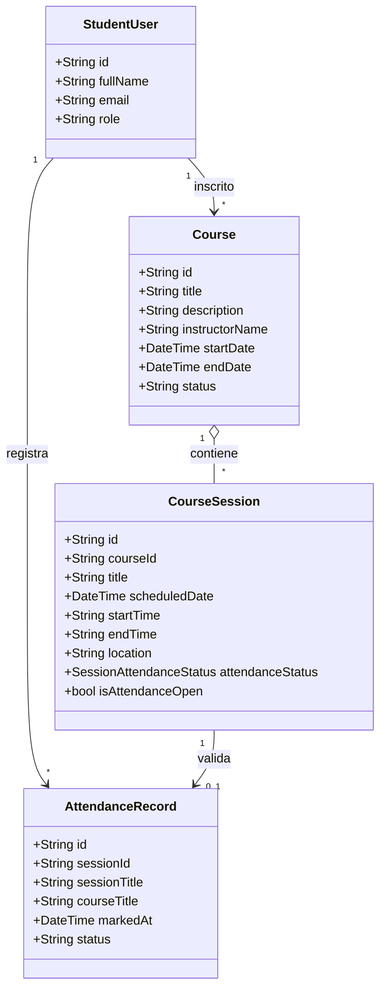

# Mobile Data Model: MVP de Gestión de Capacitaciones

**Feature**: `specs/001-mobile-training-mvp`  
**Date**: 2026-11-17  
**Scope**: Modelos de datos y DTOs en Dart para el cliente móvil Flutter.

---

## 1. Entidades del Dominio Móvil

### 1.1. `StudentUser` (Usuario Estudiante)
Representa al usuario estudiante autenticado dentro de la aplicación móvil.

```dart
class StudentUser {
  final String id;
  final String fullName;
  final String email;
  final String role; // Esperado: 'STUDENT'

  const StudentUser({
    required this.id,
    required this.fullName,
    required this.email,
    required this.role,
  });

  factory StudentUser.fromJson(Map<String, dynamic> json) {
    return StudentUser(
      id: json['id'] as String,
      fullName: json['fullName'] as String? ?? json['name'] as String,
      email: json['email'] as String,
      role: json['role'] as String? ?? 'STUDENT',
    );
  }

  Map<String, dynamic> toJson() => {
    'id': id,
    'fullName': fullName,
    'email': email,
    'role': role,
  };
}
```

---

### 1.2. `AuthSession` (Sesión y Credenciales)
Gestiona el estado en memoria y persistente del token de acceso JWT.

```dart
class AuthSession {
  final String token;
  final StudentUser user;
  final DateTime? expiresAt;

  const AuthSession({
    required this.token,
    required this.user,
    this.expiresAt,
  });

  bool get isValid => token.isNotEmpty;
}
```

---

### 1.3. `Course` (Capacitación / Curso Inscrito)
Representa un curso formativo en el que el estudiante se encuentra inscrito.

```dart
class Course {
  final String id;
  final String title;
  final String? description;
  final String instructorName;
  final DateTime startDate;
  final DateTime endDate;
  final String status; // 'ACTIVE', 'COMPLETED', 'ARCHIVED'

  const Course({
    required this.id,
    required this.title,
    this.description,
    required this.instructorName,
    required this.startDate,
    required this.endDate,
    required this.status,
  });

  factory Course.fromJson(Map<String, dynamic> json) {
    return Course(
      id: json['id'] as String,
      title: json['title'] as String,
      description: json['description'] as String?,
      instructorName: json['instructorName'] as String? ?? 'Instructor asignado',
      startDate: DateTime.parse(json['startDate'] as String),
      endDate: DateTime.parse(json['endDate'] as String),
      status: json['status'] as String? ?? 'ACTIVE',
    );
  }
}
```

---

### 1.4. `CourseSession` (Sesión Programada)
Representa un evento o clase programada dentro de una capacitación.

```dart
enum SessionAttendanceStatus {
  scheduled, // 'SCHEDULED' - Aún no iniciada o no abierta
  open,      // 'OPEN' - Con asistencia abierta y QR proyectándose
  closed,    // 'CLOSED' - Asistencia finalizada
}

class CourseSession {
  final String id;
  final String courseId;
  final String title;
  final DateTime scheduledDate;
  final String startTime; // Formato HH:mm
  final String endTime;   // Formato HH:mm
  final String location;  // Texto descriptivo (ej. "Aula Magna 201")
  final SessionAttendanceStatus attendanceStatus;

  const CourseSession({
    required this.id,
    required this.courseId,
    required this.title,
    required this.scheduledDate,
    required this.startTime,
    required this.endTime,
    required this.location,
    required this.attendanceStatus,
  });

  bool get isAttendanceOpen => attendanceStatus == SessionAttendanceStatus.open;

  factory CourseSession.fromJson(Map<String, dynamic> json) {
    SessionAttendanceStatus parseStatus(String? raw) {
      switch (raw?.toUpperCase()) {
        case 'OPEN':
          return SessionAttendanceStatus.open;
        case 'CLOSED':
          return SessionAttendanceStatus.closed;
        default:
          return SessionAttendanceStatus.scheduled;
      }
    }

    return CourseSession(
      id: json['id'] as String,
      courseId: json['courseId'] as String,
      title: json['title'] as String,
      scheduledDate: DateTime.parse(json['scheduledDate'] as String),
      startTime: json['startTime'] as String? ?? '',
      endTime: json['endTime'] as String? ?? '',
      location: json['location'] as String? ?? 'Modalidad Presencial',
      attendanceStatus: parseStatus(json['attendanceStatus'] as String?),
    );
  }
}
```

---

### 1.5. `AttendanceRecord` (Constancia de Asistencia)
Representa una asistencia validada y registrada para el estudiante.

```dart
class AttendanceRecord {
  final String id;
  final String sessionId;
  final String sessionTitle;
  final String courseTitle;
  final DateTime markedAt;
  final String status; // 'CONFIRMED'

  const AttendanceRecord({
    required this.id,
    required this.sessionId,
    required this.sessionTitle,
    required this.courseTitle,
    required this.markedAt,
    required this.status,
  });

  factory AttendanceRecord.fromJson(Map<String, dynamic> json) {
    return AttendanceRecord(
      id: json['id'] as String,
      sessionId: json['sessionId'] as String,
      sessionTitle: json['sessionTitle'] as String? ?? 'Sesión formativa',
      courseTitle: json['courseTitle'] as String? ?? 'Capacitación',
      markedAt: DateTime.parse(json['markedAt'] as String),
      status: json['status'] as String? ?? 'CONFIRMED',
    );
  }
}
```

---

### 1.6. `AttendanceScanResult` (Resultado del Marcado de Asistencia)
Modelo de respuesta para la retroalimentación visual al escanear el QR.

```dart
enum ScanOutcome {
  success,        // 200/201: Asistencia registrada con éxito
  duplicate,      // 409/400: Asistencia ya registrada previamente
  expired,        // 410/400: Token QR caducado
  invalid,        // 404/422: Token irreconocible o manipulado
  sessionClosed,  // 400: Sesión cerrada por el instructor
  unauthorized,   // 403: Estudiante no inscrito en este curso
  networkError,   // Fallo de conexión o timeout
}

class AttendanceScanResult {
  final ScanOutcome outcome;
  final String message;
  final AttendanceRecord? record;

  const AttendanceScanResult({
    required this.outcome,
    required this.message,
    this.record,
  });

  bool get isSuccess => outcome == ScanOutcome.success;
}
```

---

## 2. Diagrama de Relaciones en el Cliente Móvil


