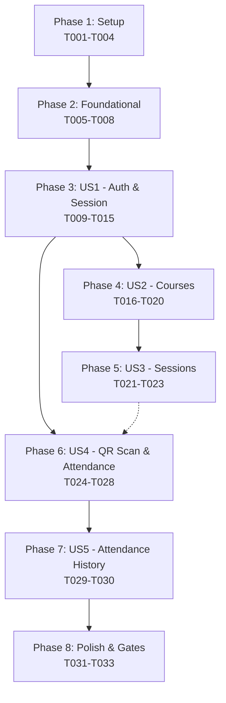

# Tasks: MVP de Aplicación Móvil de Gestión de Capacitaciones

**Input**: Design documents from `/specs/001-mobile-training-mvp/`  
**Prerequisites**: `plan.md` (required), `spec.md` (required), `research.md`, `data-model.md`, `contracts/`, `quickstart.md`  
**Target Platform**: Flutter / Android (Entrega 2)  
**Organization**: Tareas agrupadas por fases y por historias de usuario para permitir entregas incrementales e independientes.

---

## Format: `- [ ] [ID] [P?] [Story?] Description with file path`

- **[P]**: Tarea paralelizable (archivos independientes, sin dependencias bloqueantes)
- **[Story]**: Historia de usuario a la que pertenece (`[US1]`, `[US2]`, `[US3]`, `[US4]`, `[US5]`)
- Rutas de archivo exactas en cada tarea

---

## Phase 1: Setup (Infraestructura y Dependencias)

**Propósito**: Configuración del proyecto base, paquetes y permisos nativos de Android.

- [x] T001 Actualizar dependencias (`http`, `flutter_secure_storage`, `shared_preferences`, `provider`, `mobile_scanner`) en `pubspec.yaml`
- [x] T002 [P] Configurar permisos (cámara, internet) y permitir tráfico HTTP local únicamente en debug en `android/app/src/main/AndroidManifest.xml` y `android/app/src/debug/AndroidManifest.xml`
- [x] T003 [P] Implementar paleta de colores Material 3 y tema institucional en `lib/config/app_theme.dart`
- [x] T004 [P] Implementar gestor de configuración de URL base con persistencia local en `lib/config/app_config.dart`

---

## Phase 2: Foundational (Núcleo de Red y Almacenamiento Seguro)

**Propósito**: Servicios base indispensables requeridos antes de implementar las historias de usuario.

**⚠️ CRÍTICO**: Completar esta fase antes de iniciar la lógica de las historias de usuario.

- [x] T005 [P] Implementar clase utilitaria `Result<T>` para manejo robusto de éxito/fallo en `lib/core/result.dart`
- [x] T006 [P] Implementar servicio `SessionStorage` con `flutter_secure_storage` para tokens JWT en `lib/core/session_storage.dart`
- [x] T007 Implementar cliente HTTP centralizado `ApiClient` con inyección de headers `Bearer` y mapeo de errores HTTP en `lib/core/api_client.dart`
- [x] T008 [P] Crear pruebas unitarias para `SessionStorage` y `ApiClient` en `test/unit/core_test.dart`

**Checkpoint**: Núcleo de red y seguridad listo para consumir contratos de la API REST.

---

## Phase 3: User Story 1 - Autenticación y Control de Sesión (Priority: P1) 🎯 MVP

**Meta**: Permitir al estudiante iniciar sesión con credenciales, guardar de forma segura su sesión, configurar la URL del servidor, consultar su perfil y cerrar sesión.

**Criterio de Prueba Independiente**: Ingresar credenciales válidas en `login_screen.dart`, verificar que se guarde el token en almacenamiento seguro y se navegue a la pantalla principal; comprobar que credenciales incorrectas muestren alerta de error; y verificar que cerrar sesión purgue el token y redirija al login.

- [x] T009 [P] [US1] Crear modelo de datos `StudentUser` y deserializador JSON en `lib/models/student_user.dart`
- [x] T010 [P] [US1] Crear pruebas unitarias para serialización de `StudentUser` en `test/unit/student_user_test.dart`
- [x] T011 [US1] Implementar `AuthProvider` con operaciones de login, logout y validación de sesión activa en `lib/providers/auth_provider.dart`
- [x] T012 [P] [US1] Implementar diálogo emergente para editar la URL base de conexión en `lib/screens/widgets/server_config_dialog.dart`
- [x] T013 [US1] Implementar pantalla de inicio de sesión con validaciones de formulario en `lib/screens/login_screen.dart`
- [x] T014 [US1] Implementar estructura de navegación base con pestañas principales y opción de cerrar sesión en `lib/screens/home_screen.dart`
- [x] T015 [US1] Crear prueba de widgets para validaciones y estados de carga en `test/widget/login_screen_test.dart`

**Checkpoint**: Flujo de autenticación completo y verificable de manera aislada (MVP funcional).

---

## Phase 4: User Story 2 - Consulta de Capacitaciones e Inscripciones (Priority: P1)

**Meta**: Mostrar al estudiante la lista de cursos en los que está formalmente inscrito con título, instructor, fechas y los 4 estados de interfaz (*Loading*, *Content*, *Empty*, *Error* con reintento).

**Criterio de Prueba Independiente**: Acceder a "Mis Capacitaciones" con token válido; verificar listado de cursos asignados; verificar mensaje amigable cuando no tiene cursos; simular fallo de red y pulsar botón "Reintentar".

- [x] T016 [P] [US2] Crear modelo de datos `Course` y deserializador JSON en `lib/models/course.dart`
- [x] T017 [US2] Implementar `CoursesProvider` con consulta `/student/courses` y gestión de estados asíncronos en `lib/providers/courses_provider.dart`
- [x] T018 [P] [US2] Implementar componentes visuales reutilizables para estado vacío y error con reintento en `lib/screens/widgets/state_views.dart`
- [x] T019 [US2] Implementar vista de listado de cursos con soporte para gesto *Pull-to-Refresh* en `lib/screens/courses_screen.dart`
- [x] T020 [US2] Crear prueba de widgets para los 4 estados asíncronos de la lista de cursos en `test/widget/courses_screen_test.dart`

**Checkpoint**: El estudiante puede consultar su catálogo de capacitaciones inscritas de forma reactiva.

---

## Phase 5: User Story 3 - Consulta de Sesiones y Cronograma (Priority: P2)

**Meta**: Permitir al estudiante seleccionar un curso y ver el cronograma ordenado de sesiones con horario, ubicación y estado de asistencia (`SCHEDULED`, `OPEN`, `CLOSED`).

**Criterio de Prueba Independiente**: Seleccionar un curso desde la lista y verificar que se despliegue el detalle de sesiones con badges de estado; verificar que la sesión con estado `OPEN` destaque visualmente con botón de marcado.

- [x] T021 [P] [US3] Crear modelo de datos `CourseSession` y enumerador `SessionAttendanceStatus` en `lib/models/course_session.dart`
- [x] T022 [US3] Integrar consulta de sesiones `/student/courses/:id/sessions` dentro de `lib/providers/courses_provider.dart`
- [x] T023 [US3] Implementar pantalla de detalle de capacitación con lista de sesiones y distintivo de estado en `lib/screens/session_detail_screen.dart`

**Checkpoint**: Cronograma de sesiones navegable y vinculado a las capacitaciones del estudiante.

---

## Phase 6: User Story 4 - Escaneo de Código QR y Registro de Asistencia (Priority: P1)

**Meta**: Permitir al estudiante escanear el código QR dinámico mediante la cámara (acceso dual: botón principal y sesión abierta), procesar la validación en el servidor y presentar retroalimentación visual clara (éxito, duplicado, vencido, sesión cerrada, no inscrito).

**Criterio de Prueba Independiente**: Conceder permisos de cámara, capturar un código QR emitido por el servidor y comprobar la presentación del modal de éxito; probar con código repetido y verificar aviso de "Asistencia previamente registrada"; probar con código vencido y comprobar aviso de expiración.

- [x] T024 [P] [US4] Crear modelos `AttendanceRecord`, `AttendanceScanResult` y enum `ScanOutcome` en `lib/models/attendance_models.dart`
- [x] T025 [US4] Implementar método de escaneo y envío `/student/attendance/scan` en `lib/providers/attendance_provider.dart`
- [x] T026 [US4] Implementar pantalla de escaneo con `mobile_scanner`, solicitud contextual de permisos, soporte de cámara virtual en emulador y bloqueo anti-ráfagas en `lib/screens/qr_scanner_screen.dart`
- [x] T027 [US4] Implementar diálogos modales de retroalimentación diferenciada para cada resultado del escaneo en `lib/screens/widgets/scan_result_dialog.dart`
- [x] T028 [US4] Conectar los accesos duales al escáner en `lib/screens/home_screen.dart` y `lib/screens/session_detail_screen.dart`

**Checkpoint**: Flujo completo de marcado de asistencia móvil mediante código QR dinámico operativo.

---

## Phase 7: User Story 5 - Consulta de Historial de Asistencias (Priority: P2)

**Meta**: Mostrar al estudiante la lista cronológica de sus asistencias confirmadas con nombre de curso, tema de sesión y fecha/hora registrada.

**Criterio de Prueba Independiente**: Acceder a la sección de historial tras registrar una asistencia y comprobar que aparezca listada correctamente; comprobar el estado vacío para usuarios sin registros.

- [x] T029 [US5] Implementar consulta de historial `/student/attendance/history` en `lib/providers/attendance_provider.dart`
- [x] T030 [US5] Implementar pantalla de historial de asistencias con pull-to-refresh y estado vacío en `lib/screens/attendance_history_screen.dart`

**Checkpoint**: Trazabilidad completa de asistencias para el estudiante.

---

## Phase 8: Polish & Cross-Cutting Concerns

**Propósito**: Integración global, consistencia de navegación, análisis estático y verificación final.

- [x] T031 Integrar punto de entrada principal con inyección de providers y rutas en `lib/main.dart`
- [x] T032 [P] Ejecutar análisis estático con `flutter analyze` y resolver cualquier advertencia o lint
- [x] T033 Ejecutar los escenarios de validación de extremo a extremo definidos en `specs/001-mobile-training-mvp/quickstart.md`

---

## Dependencies & Execution Order

### Oportunidades de Paralelización

- **Fase 1**: T002, T003 y T004 se pueden ejecutar en paralelo una vez completado T001.
- **Fase 2**: T005 y T006 se pueden desarrollar en paralelo antes de T007.
- **Fase 3**: T009, T010 y T012 son paralelizables.
- **Fase 4 & 6**: Una vez completada la Autenticación (US1), la visualización de cursos (US2) y el módulo base de escaneo QR (US4) pueden desarrollarse simultáneamente por dos desarrolladores.

---

## Estrategia de Implementación

### Alcance MVP Inicial (Entrega 2 - Núcleo Esencial)
1. Completar **Fase 1 (Setup)** y **Fase 2 (Foundational)**.
2. Implementar **Fase 3 (US1 - Login)** $\rightarrow$ Probar ingreso con credenciales y guardado de token.
3. Implementar **Fase 4 (US2 - Cursos)** $\rightarrow$ Visualizar cursos asignados al alumno.
4. Implementar **Fase 6 (US4 - Escaneo QR)** $\rightarrow$ Demostrar marcado exitoso, asistencia duplicada y token vencido.
5. Completar **Fase 5 (Sesiones)** y **Fase 7 (Historial)** para cerrar la experiencia completa del estudiante.
