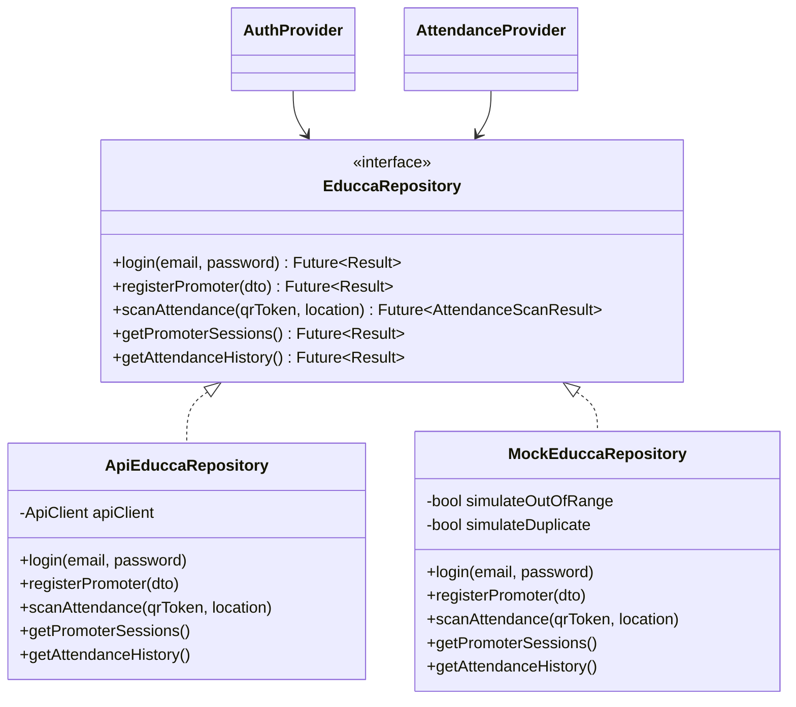

# Data Model: Adaptación Móvil EDUCCA Cusco — Sprint 1

**Feature**: `002-educca-mobile-sprint1`  
**Date**: 2026-11-17  
**Status**: Completed

Este documento detalla los modelos de dominio, estructuras DTO y enumeradores que utiliza el cliente móvil Flutter para el Sprint 1 de EDUCCA Cusco.

---

## 1. Enumeradores de Dominio

### 1.1 `PromoterCategory`
Representa las categorías reconocidas para los promotores ambientales según la directiva del programa municipal EDUCCA.

```dart
enum PromoterCategory {
  escolar,     // Promotores ambientales escolares (colegios de Cusco)
  juvenil,     // Promotores ambientales juveniles (universitarios / institutos)
  comunitario, // Promotores ambientales comunitarios (vecinos / juntas vecinales)
}
```

*Regla de serialización:* Se transmite en mayúsculas (`ESCOLAR`, `JUVENIL`, `COMUNITARIO`) hacia el backend en Go, tolerando minúsculas en parsing.

### 1.2 `ScanOutcome` (Extendido)
Representa el resultado categorizado tras intentar marcar asistencia presencial con QR y GPS.

```dart
enum ScanOutcome {
  success,             // 200/201: Asistencia validada por backend dentro de 80 m
  duplicate,           // 409/ALREADY_RECORDED: Asistencia previamente registrada
  outOfRange,          // 400/OUT_OF_RANGE: Distancia a sede > 80 metros
  expired,             // 410/QR_EXPIRED: Token QR dinámico caducado
  invalid,             // 404/422/QR_INVALID: Token corrupto o irreconocible
  sessionClosed,       // 400/SESSION_CLOSED: Sesión no abierta para marcado
  unauthorized,        // 403/NOT_ENROLLED: Promotor no autorizado/inscrito
  permissionDenied,    // Error local: Permiso de ubicación rechazado en Android
  gpsDisabled,         // Error local: Servicios de ubicación (GPS) apagados
  locationInaccurate,  // Error local: Margen de error GPS > 50 metros
  gpsTimeout,          // Error local: Excedido timeout de 10 s para fijar satélites
  networkError,        // Error local/HTTP: Falla de conexión o timeout de red
}
```

---

## 2. Entidades y Modelos de Datos

### 2.1 `PromoterUser` (Adaptado de `StudentUser`)
Modela la identidad y perfil del usuario autenticado en el dispositivo móvil.

```dart
class PromoterUser {
  final String id;
  final String fullName;
  final String email;
  final String role; // 'PROMOTOR', 'STUDENT' (compatibilidad retroactiva)
  final PromoterCategory promoterCategory;
  final bool isAdult;
  final bool privacyConsentAccepted;

  const PromoterUser({
    required this.id,
    required this.fullName,
    required this.email,
    required this.role,
    required this.promoterCategory,
    required this.isAdult,
    required this.privacyConsentAccepted,
  });

  factory PromoterUser.fromJson(Map<String, dynamic> json) {
    // Parsing tolerante para compatibilidad retroactiva con /student/login
    final rawCategory = json['promoterCategory']?.toString().toUpperCase();
    PromoterCategory category;
    switch (rawCategory) {
      case 'ESCOLAR':
        category = PromoterCategory.escolar;
        break;
      case 'COMUNITARIO':
        category = PromoterCategory.comunitario;
        break;
      default:
        category = PromoterCategory.juvenil;
    }

    return PromoterUser(
      id: json['id'] as String? ?? '',
      fullName: json['fullName'] as String? ?? json['name'] as String? ?? '',
      email: json['email'] as String? ?? '',
      role: json['role'] as String? ?? 'PROMOTOR',
      promoterCategory: category,
      isAdult: json['isAdult'] as bool? ?? true,
      privacyConsentAccepted: json['privacyConsentAccepted'] as bool? ?? true,
    );
  }

  Map<String, dynamic> toJson() => {
    'id': id,
    'fullName': fullName,
    'email': email,
    'role': role,
    'promoterCategory': promoterCategory.name.toUpperCase(),
    'isAdult': isAdult,
    'privacyConsentAccepted': privacyConsentAccepted,
  };
}
```

### 2.2 `LocationCapture` (Captura Efímera de Coordenadas)
Estructura en memoria utilizada exclusivamente para transmitir la lectura puntual al backend Go.

```dart
class LocationCapture {
  final double latitude;
  final double longitude;
  final double accuracyMeters;
  final DateTime capturedAt;

  const LocationCapture({
    required this.latitude,
    required this.longitude,
    required this.accuracyMeters,
    required this.capturedAt,
  });

  Map<String, dynamic> toJson() => {
    'latitude': latitude,
    'longitude': longitude,
    'accuracyMeters': accuracyMeters,
    'capturedAt': capturedAt.toIso8601String(),
  };
}
```

*Regla de privacidad (RNF-01):* Esta clase no cuenta con serializadores a disco (`SharedPreferences` ni `SQLite`). Una vez enviado el payload, la instancia es descartada del Garbage Collector.

### 2.3 `AttendanceRecord` y `AttendanceScanResult`
Modela la constancia devuelta por el servidor tras una asistencia exitosa o duplicada.

```dart
class AttendanceRecord {
  final String id;
  final String sessionId;
  final String sessionTitle;
  final String venueName;
  final DateTime markedAt;
  final String status; // 'RECORDED', 'CONFIRMED'

  const AttendanceRecord({
    required this.id,
    required this.sessionId,
    required this.sessionTitle,
    required this.venueName,
    required this.markedAt,
    required this.status,
  });

  factory AttendanceRecord.fromJson(Map<String, dynamic> json) {
    DateTime parseDate(dynamic value) {
      if (value == null) return DateTime.now();
      return DateTime.tryParse(value.toString()) ?? DateTime.now();
    }

    return AttendanceRecord(
      id: json['id'] as String? ?? json['attendanceId'] as String? ?? '',
      sessionId: json['sessionId'] as String? ?? json['session']?['id'] as String? ?? '',
      sessionTitle: json['sessionTitle'] as String? ?? json['session']?['title'] as String? ?? 'Taller Ambiental',
      venueName: json['venueName'] as String? ?? json['session']?['venueName'] as String? ?? 'Sede EDUCCA Cusco',
      markedAt: parseDate(json['markedAt'] ?? json['recordedAt']),
      status: json['status'] as String? ?? 'RECORDED',
    );
  }
}

class AttendanceScanResult {
  final ScanOutcome outcome;
  final String message;
  final AttendanceRecord? record;

  const AttendanceScanResult({
    required this.outcome,
    required this.message,
    this.record,
  });

  bool get isSuccess => outcome == ScanOutcome.success;
  bool get isDuplicate => outcome == ScanOutcome.duplicate;
  bool get isOutOfRange => outcome == ScanOutcome.outOfRange;
  bool get isExpired => outcome == ScanOutcome.expired;
}
```

---

## 3. Estado de la Aplicación y Repositorio Desacoplado


