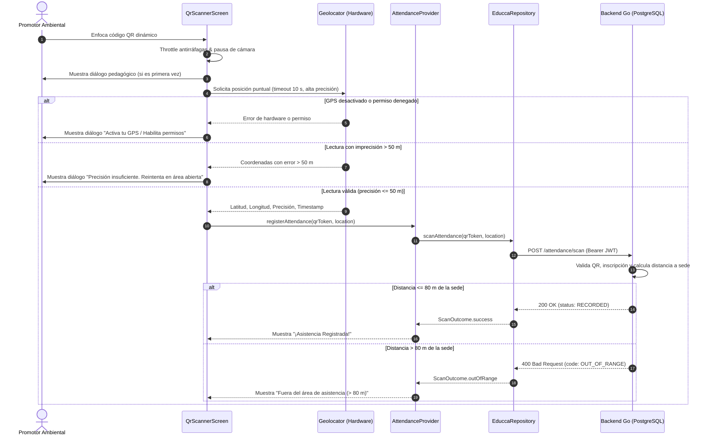

# Implementation Plan: Adaptación Móvil EDUCCA Cusco — Sprint 1

**Branch**: `002-educca-mobile-sprint1` | **Date**: 2026-11-17 | **Spec**: [specs/002-educca-mobile-sprint1/spec.md](spec.md)  
**Input**: Especificación funcional y aclaraciones para adaptar el MVP móvil existente al Sprint 1 del Programa Municipal EDUCCA Cusco (HU-01, HU-04, RNF-01).

---

## 1. Summary

Adaptar de forma brownfield e incremental la aplicación Flutter existente en `lib/` para el perfil del **Promotor Ambiental** de EDUCCA Cusco, reutilizando los componentes base (`ApiClient`, `SessionStorage`, `Result<T>`, `AppConfig`, `state_views.dart`, visor de cámara con `mobile_scanner`).

El alcance abarca:
1. **HU-01:** Incorporar la pantalla de registro para promotores (`escolar`, `juvenil`, `comunitario`) con aviso de consentimiento informado y contención de menores de edad (Opción A de aclaración), conservando el inicio/cierre de sesión seguro con JWT en Keystore.
2. **HU-04:** Extender el escaneo QR con la captura puntual de geolocalización satelital (`geolocator`), con timeout de 10 s y filtro de precisión de 50 m (Opción A de aclaración), delegando al backend en Go la validación de la geocerca de 80 m de la sede.
3. **RNF-01:** Prohibir el tracking continuo, evitar persistir coordenadas en disco y no emitir datos sensibles en logs.
4. **Integración Desacoplada:** Introducir la interfaz `EduccaRepository` con implementaciones `ApiEduccaRepository` y `MockEduccaRepository` (disponible únicamente bajo debug para pruebas de UI sin depender del despliegue del compañero de backend).

---

## 2. Technical Context

* **Language/Framework**: Flutter 3.x / Dart SDK `^3.14.0`.
* **Primary Dependencies**:
  * Existentes conservadas: `http: ^1.2.2`, `flutter_secure_storage: ^9.2.2`, `shared_preferences: ^2.3.2`, `provider: ^6.1.2`, `mobile_scanner: ^6.0.4`, `cupertino_icons: ^1.0.8`.
  * Nueva requerida: `geolocator: ^13.0.2` (para captura puntual de ubicación en Android).
* **Storage**: Android Keystore / EncryptedSharedPreferences (vía `flutter_secure_storage`) para JWT y datos de sesión de promotor. Cero persistencia local de coordenadas GPS.
* **Testing**: `flutter_test`, `MockClient` de `http/testing.dart`, mocks de almacenamiento seguro en memoria.
* **Target Platform**: Android 8.0+ (API Level 26+).
* **Project Type**: Aplicación móvil cliente nativa.
* **Constraints**:
  * Captura GPS en un solo disparo (*single-shot*) con timeout de 10 s y error máximo de 50 m.
  * Cero procesos de ubicación en segundo plano (prohibido `ACCESS_BACKGROUND_LOCATION`).
  * Validación de 80 m calculada estrictamente en el backend en Go.
  * Preservar código de `specs/001-mobile-training-mvp/` sin sobreescribirlo.

---

## 3. Constitution Check (v3.0.0 Evaluation)

| Principio Constitucional | Regla Aplicable | Evaluación en el Plan | Estado |
|---|---|---|:---:|
| **Principio I** (API Contracts & Backend Authority) | El backend Go + Postgres valida QR, inscripción y geocerca de 80 m. El cliente móvil no auto-certifica asistencias. | El plan delega la decisión de 80 m al servidor y modela `EduccaRepository` desacoplado con DTOs adaptables. | **PASS** |
| **Principio II** (Privacy-Preserving QR & Single-Point GPS) | Captura de GPS puntual al marcar. Prohibido tracking en background, listeners pasivos y persistencia de coordenadas. | Se utiliza `Geolocator.getCurrentPosition` con timeout de 10 s y descarte inmediato de coordenadas en memoria. | **PASS** |
| **Principio III** (LPDP, Ética y Consentimiento) | Consentimiento informado explícito en registro. No autorizar menores autónomamente sin aval del PO. | Formulario incluye aviso de privacidad obligatorio y bloqueo condicional de escolares menores de edad. | **PASS** |
| **Principio IV** (Arquitectura Modular y Reutilización) | Reutilizar código existente sin capas redundantes. Roles administrativos reservados para web. | Se reutilizan `ApiClient`, `SessionStorage`, widgets y proveedores actuales, agregando solo pantalla de registro y GPS. | **PASS** |
| **Principio V** (Quality Gates y Verificación) | Cero errores en `flutter analyze`, pruebas automatizadas y soporte de los 4 estados asíncronos. | Se planifican pruebas de widgets y unitarias para registro, GPS y diálogos modales. | **PASS** |

---

## 4. Matriz de Archivos: Conservados, Modificados y Nuevos

### 4.1 Archivos Existentes que se CONSERVAN (Sin Cambios o Solo Reutilización)
* [lib/core/api_client.dart](file:///C:/Users/Fidel/Desktop/sistema-capacitaciones/lib/core/api_client.dart): Cliente HTTP con inyección de cabeceras Bearer y captura de 401.
* [lib/core/session_storage.dart](file:///C:/Users/Fidel/Desktop/sistema-capacitaciones/lib/core/session_storage.dart): Almacenamiento seguro en Android Keystore.
* [lib/core/result.dart](file:///C:/Users/Fidel/Desktop/sistema-capacitaciones/lib/core/result.dart): Clase funcional para encapsular respuestas Success/Failure.
* [lib/config/app_config.dart](file:///C:/Users/Fidel/Desktop/sistema-capacitaciones/lib/config/app_config.dart): Gestión reactiva de la URL base del servidor.
* [lib/config/app_theme.dart](file:///C:/Users/Fidel/Desktop/sistema-capacitaciones/lib/config/app_theme.dart): Paleta de colores institucional Material 3.
* [lib/screens/widgets/server_config_dialog.dart](file:///C:/Users/Fidel/Desktop/sistema-capacitaciones/lib/screens/widgets/server_config_dialog.dart): Ajuste de host/puerto en debug.
* [lib/screens/widgets/state_views.dart](file:///C:/Users/Fidel/Desktop/sistema-capacitaciones/lib/screens/widgets/state_views.dart): Vistas de carga, estado vacío y error con reintento.
* [lib/screens/courses_screen.dart](file:///C:/Users/Fidel/Desktop/sistema-capacitaciones/lib/screens/courses_screen.dart): Catálogo de talleres (reetiquetado visual).
* [lib/screens/session_detail_screen.dart](file:///C:/Users/Fidel/Desktop/sistema-capacitaciones/lib/screens/session_detail_screen.dart): Detalle de sesiones programadas.
* [lib/screens/attendance_history_screen.dart](file:///C:/Users/Fidel/Desktop/sistema-capacitaciones/lib/screens/attendance_history_screen.dart): Historial complementario.
* [test/unit/core_test.dart](file:///C:/Users/Fidel/Desktop/sistema-capacitaciones/test/unit/core_test.dart): Suite unitaria de red y almacenamiento.

### 4.2 Archivos Existentes que se MODIFICAN
* [pubspec.yaml](file:///C:/Users/Fidel/Desktop/sistema-capacitaciones/pubspec.yaml): Agregar dependencia `geolocator: ^13.0.2`.
* [android/app/src/main/AndroidManifest.xml](file:///C:/Users/Fidel/Desktop/sistema-capacitaciones/android/app/src/main/AndroidManifest.xml): Declarar permisos `ACCESS_FINE_LOCATION` y `ACCESS_COARSE_LOCATION` (sin background).
* [lib/models/student_user.dart](file:///C:/Users/Fidel/Desktop/sistema-capacitaciones/lib/models/student_user.dart) (o nuevo [promoter_user.dart](file:///C:/Users/Fidel/Desktop/sistema-capacitaciones/lib/models/promoter_user.dart)): Adaptar a `PromoterUser` con soporte para categoría y compatibilidad retroactiva.
* [lib/models/attendance_models.dart](file:///C:/Users/Fidel/Desktop/sistema-capacitaciones/lib/models/attendance_models.dart): Extender `ScanOutcome` con `outOfRange`, `permissionDenied`, `gpsDisabled`, `locationInaccurate` y `gpsTimeout`.
* [lib/providers/auth_provider.dart](file:///C:/Users/Fidel/Desktop/sistema-capacitaciones/lib/providers/auth_provider.dart): Integrar método `registerPromoter(...)` delegando en el repositorio.
* [lib/providers/attendance_provider.dart](file:///C:/Users/Fidel/Desktop/sistema-capacitaciones/lib/providers/attendance_provider.dart): Integrar adquisición puntual con `geolocator` (timeout 10 s / filtro 50 m) y envío de payload con ubicación.
* [lib/screens/login_screen.dart](file:///C:/Users/Fidel/Desktop/sistema-capacitaciones/lib/screens/login_screen.dart): Agregar enlace a pantalla de registro y selector de modo demo en debug.
* [lib/screens/qr_scanner_screen.dart](file:///C:/Users/Fidel/Desktop/sistema-capacitaciones/lib/screens/qr_scanner_screen.dart): Mostrar diálogo pedagógico previo de permisos GPS antes del primer marcado.
* [lib/screens/widgets/scan_result_dialog.dart](file:///C:/Users/Fidel/Desktop/sistema-capacitaciones/lib/screens/widgets/scan_result_dialog.dart): Manejo visual de alertas para fuera de radio (> 80 m), GPS inactivo y precisión deficiente.
* [lib/screens/home_screen.dart](file:///C:/Users/Fidel/Desktop/sistema-capacitaciones/lib/screens/home_screen.dart): Reetiquetar términos visuales a «EDUCCA Cusco» y mostrar categoría del promotor.

### 4.3 Archivos NUEVOS
* `lib/repositories/educca_repository.dart`: Interfaz abstracta del repositorio.
* `lib/repositories/api_educca_repository.dart`: Implementación real que consume `ApiClient`.
* `lib/repositories/mock_educca_repository.dart`: Implementación simulada para debug y pruebas de interfaz.
* `lib/screens/register_screen.dart`: Pantalla de registro de promotor con selector de categoría, confirmación de mayoría de edad y consentimiento informado.
* `lib/screens/widgets/privacy_consent_dialog.dart`: Diálogo modal con el texto del aviso de privacidad y consentimiento LPDP.
* `test/unit/promoter_user_test.dart`: Pruebas de serialización de roles, categorías y consentimientos.
* `test/widget/register_screen_test.dart`: Pruebas de widgets para validaciones de formulario y bloqueo de menores.
* `test/widget/scan_result_dialog_test.dart`: Pruebas de renderizado para `outOfRange`, `locationInaccurate` y `permissionDenied`.

---

## 5. Arquitectura del Flujo Asíncrono de Marcado (HU-04)

---

## 6. Estrategia de Verificación y Quality Gates

1. **Gate Estático**: `flutter analyze` debe pasar con 0 errores y 0 warnings.
2. **Gate de Regresión**: Las pruebas existentes en [test/unit/core_test.dart](file:///C:/Users/Fidel/Desktop/sistema-capacitaciones/test/unit/core_test.dart), `test/widget/login_screen_test.dart` y `test/widget/courses_screen_test.dart` deben continuar pasando al 100%.
3. **Nuevas Pruebas Automatizadas**:
   * Validación unitaria de serialización de `PromoterUser` (tolerancia a nulls, valores antiguos y nuevas categorías).
   * Validación de formulario de registro: campos vacíos, correos malformados, passwords dispares, y verificación de que seleccionar «Escolar» + «Menor de edad» deshabilita el botón de registro.
   * Validación de diálogo de escaneo: verificar que `ScanOutcome.outOfRange` renderiza el ícono, título y color de advertencia adecuados.
4. **Pruebas de Emulador**: Simular ubicaciones satelitales en Android Studio AVD (dentro y fuera de 80 m) para constatar el comportamiento ante las respuestas simuladas o reales.
