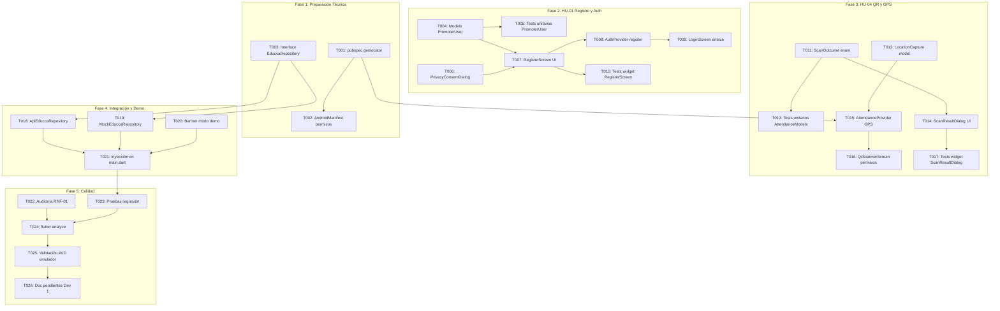

# Tasks: Adaptación Móvil EDUCCA Cusco — Sprint 1

**Input**: Artefactos de diseño de `/specs/002-educca-mobile-sprint1/` (`spec.md`, `plan.md`, `research.md`, `data-model.md`, `contracts/`, `quickstart.md`).  
**Prerequisites**: `plan.md` (completado), `spec.md` (completado con aclaraciones), `constitution.md` (v3.0.0).  
**Target Platform**: Flutter / Android (API 26+ / Android 8.0+).  
**Organization**: Tareas agrupadas por fases y por historias de usuario para entrega incremental independiente.

---

## Formato de Tareas: `- [ ] [TaskID] [P?] [Story?] Descripción con ruta de archivo`

* **[P]**: Tarea paralelizable (archivos independientes, sin dependencias bloqueantes).
* **[Story]**: Historia de usuario vinculada (`[US1]` = HU-01 Registro/Auth, `[US2]` = HU-04 Asistencia QR+GPS).
* Todas las tareas incluyen rutas de archivo exactas.

---

## Fase 1: Preparación Técnica y Dependencias (Setup & Foundation)

**Propósito**: Configuración de dependencias nativas de Android, permisos de geolocalización e interfaces base sin tocar la lógica de negocio.

- [x] T001 Actualizar `pubspec.yaml` incorporando la dependencia `geolocator: ^13.0.2` para la captura puntual de ubicación en Android.
- [x] T002 [P] Declarar permisos `ACCESS_FINE_LOCATION` y `ACCESS_COARSE_LOCATION` en `android/app/src/main/AndroidManifest.xml`, asegurando la ausencia total de permisos en segundo plano (`ACCESS_BACKGROUND_LOCATION`) conforme a RNF-01.
- [x] T003 [P] Definir la interfaz abstracta `EduccaRepository` en `lib/repositories/educca_repository.dart` con los métodos de autenticación, registro, escaneo de asistencia y consulta de sesiones.

**Checkpoint**: Entorno nativo preparado y contrato de repositorio listo para implementar historias de usuario.

---

## Fase 2: HU-01 / RNF-01 — Registro, Autenticación y Consentimiento Informado (Priority: P1) 🎯 MVP

**Meta**: Permitir al promotor ambiental registrarse con datos válidos, seleccionar su categoría (`escolar`, `juvenil`, `comunitario`), aceptar el consentimiento informado obligatorio, aplicar la contención de escolares menores de edad y autenticarse de forma segura con JWT en Keystore.

**Criterio de Prueba Independiente**: Acceder a «Crear cuenta», verificar que al elegir «Escolar» e indicar menor de edad el botón de envío quede inactivo con aviso orientativo; verificar que para adultos con consentimiento se cree el registro; comprobar que el login conserve la sesión en `SessionStorage` y cerrar sesión purgue los tokens.

- [x] T004 [P] [US1] Adaptar el modelo de usuario `PromoterUser` en `lib/models/promoter_user.dart` (y compatibilidad retroactiva en `lib/models/student_user.dart`) con `PromoterCategory`, confirmación `isAdult`, `privacyConsentAccepted` y deserialización tolerante.
- [x] T005 [P] [US1] Crear pruebas unitarias para `PromoterUser` en `test/unit/promoter_user_test.dart` verificando serialización JSON de roles, categorías y consentimiento.
- [x] T006 [P] [US1] Implementar diálogo modal `PrivacyConsentDialog` en `lib/screens/widgets/privacy_consent_dialog.dart` con el texto oficial del aviso de privacidad y consentimiento LPDP.
- [x] T007 [US1] Implementar pantalla `RegisterScreen` en `lib/screens/register_screen.dart` con validación de nombre, correo, contraseñas coincidentes, selector de categoría (`escolar`, `juvenil`, `comunitario`), confirmación condicional de mayoría de edad para escolares y casilla obligatoria de consentimiento.
- [x] T008 [US1] Integrar la operación `registerPromoter` en `lib/providers/auth_provider.dart` delegando en el repositorio activo y gestionando errores de red y validación.
- [x] T009 [US1] Modificar `lib/screens/login_screen.dart` para añadir el enlace de navegación hacia `RegisterScreen` («¿No tienes cuenta? Regístrate aquí») conservando el flujo de login existente.
- [x] T010 [US1] Crear pruebas de widgets en `test/widget/register_screen_test.dart` validando campos obligatorios, bloqueo del botón sin consentimiento y restricción de registro a escolares menores de edad.

**Checkpoint**: Flujo de registro y autenticación del promotor EDUCCA completamente operativo y probado de forma aislada.

---

## Fase 3: HU-04 / RNF-01 — Asistencia QR Dinámica y Captura GPS Puntual (Priority: P1)

**Meta**: Capturar el token QR proyectado por el capacitador (HU-03), solicitar ubicación puntual con timeout de 10 s y filtro de 50 m, transmitir el payload autenticado al servidor y presentar la retroalimentación visual adecuada (éxito, fuera de radio > 80 m, duplicado, vencido, GPS apagado o impreciso).

**Criterio de Prueba Independiente**: Abrir escáner, enfocar QR activo con simulación de coordenadas dentro de 80 m para comprobar la confirmación; probar con coordenadas a más de 80 m para comprobar advertencia de fuera de radio; probar con GPS apagado o imprecisión > 50 m para verificar que se solicite reintento sin guardar coordenadas locales.

- [x] T011 [P] [US2] Extender el enum `ScanOutcome` y la clase `AttendanceScanResult` en `lib/models/attendance_models.dart` incorporando `outOfRange`, `permissionDenied`, `gpsDisabled`, `locationInaccurate` y `gpsTimeout`.
- [x] T012 [P] [US2] Crear modelo efímero `LocationCapture` en `lib/models/location_capture.dart` con `latitude`, `longitude`, `accuracyMeters` y `capturedAt` (estrictamente volátil en memoria, sin persistencia a disco).
- [x] T013 [P] [US2] Crear pruebas unitarias para mapeo de respuestas y estados de `ScanOutcome` en `test/unit/attendance_models_test.dart`.
- [x] T014 [US2] Extender `ScanResultDialog` en `lib/screens/widgets/scan_result_dialog.dart` con retroalimentación visual (íconos, títulos y colores) para fuera de radio (`OUT_OF_RANGE`), GPS apagado, permisos denegados y precisión insuficiente.
- [x] T015 [US2] Implementar método de adquisición puntual de coordenadas en `lib/providers/attendance_provider.dart` utilizando `geolocator` con timeout de 10 s, filtro de error ≤ 50 m y delegación del payload al repositorio.
- [x] T016 [US2] Modificar `lib/screens/qr_scanner_screen.dart` para desplegar explicación previa de privacidad antes de solicitar permisos GPS e integrar la captura geográfica instantánea tras leer el código QR.
- [x] T017 [US2] Crear pruebas de widgets en `test/widget/scan_result_dialog_test.dart` verificando renderizado de estados de fuera de radio (`outOfRange`), precisión insuficiente (`locationInaccurate`) y permisos denegados.

**Checkpoint**: Flujo de marcado presencial con validación de geocerca en servidor terminado y verificado.

---

## Fase 4: Integración Desacoplada y Modo Demostración (Foundation & Tools)

**Meta**: Permitir la alternancia fluida entre la integración HTTP real con el backend en Go y un repositorio simulado para pruebas locales independientes bajo debug.

**Criterio de Prueba Independiente**: Activar la opción de modo demostración en el diálogo de configuración de debug; verificar la aparición del distintivo visual «MODO DEMOSTRACIÓN — DATOS SIMULADOS» y comprobar que el registro y escaneo devuelvan respuestas controladas sin requerir el backend Go en ejecución.

- [x] T018 [P] Implementar `ApiEduccaRepository` en `lib/repositories/api_educca_repository.dart` consumiendo el `ApiClient` existente hacia los endpoints REST acordados (`/auth/register`, `/auth/login`, `/attendance/scan`).
- [x] T019 [P] Implementar `MockEduccaRepository` en `lib/repositories/mock_educca_repository.dart` simulando respuestas deterministas de éxito, duplicado, fuera de radio (> 80 m), QR expirado y registro de promotor.
- [x] T020 Añadir selector de modo demostración en `lib/screens/widgets/server_config_dialog.dart` y mostrar distintivo visual permanente `«MODO DEMOSTRACIÓN — DATOS SIMULADOS»` en `lib/screens/home_screen.dart` y `login_screen.dart` cuando esté activo en debug.
- [x] T021 Configurar la inyección de dependencias en `lib/main.dart` para instanciar `EduccaRepository` (`ApiEduccaRepository` o `MockEduccaRepository`) e inyectarlo en `AuthProvider` y `AttendanceProvider`.

**Checkpoint**: Aplicación desacoplada y ejecutable de forma autónoma para evaluación y pruebas de interfaz.

---

## Fase 5: Calidad, Verificación y Auditoría de Regresión

**Meta**: Asegurar estabilidad del sistema, verificar cero regresiones en código previo, auditar el estricto cumplimiento de RNF-01 y documentar las pruebas de integración pendientes con el backend real.

- [x] T022 [P] Auditar el ciclo de vida de la aplicación y el almacenamiento local (`SessionStorage`, `SharedPreferences`) para certificar que no existan coordenadas GPS persistidas en disco ni listeners en segundo plano.
- [x] T023 Ejecutar suite completa de pruebas automatizadas existentes (`test/unit/core_test.dart`, `test/widget/login_screen_test.dart`, `test/widget/courses_screen_test.dart`, `test/widget_test.dart`) verificando 100% de aprobación.
- [x] T024 Ejecutar `flutter analyze` y corregir cualquier advertencia o incidencia hasta obtener 0 errores y 0 warnings.
- [x] T025 Validar en emulador Android Studio los escenarios de prueba descritos en `quickstart.md` (modo demo y simulación GPS de AVD dentro y fuera de 80 m de la sede).
- [x] T026 Documentar en `docs/educca/PENDIENTES_INTEGRACION_BACKEND.md` la matriz de homologación final y las pruebas de integración end-to-end bloqueadas que requieren el despliegue del backend Go + PostgreSQL por Dev 1.

---

## Resumen de Dependencias y Grafo de Ejecución

---

## Oportunidades de Ejecución Paralela [P]

* **En Fase 1:** T002 (AndroidManifest) y T003 (Interfaz del repositorio) pueden desarrollarse en paralelo con T001 (pubspec).
* **En Fase 2:** T004 (Modelo `PromoterUser`), T005 (Pruebas unitarias) y T006 (Diálogo de consentimiento) son totalmente paralelizables.
* **En Fase 3:** T011 (`ScanOutcome`), T012 (`LocationCapture`) y T013 (Pruebas unitarias) son independientes de la UI y pueden implementarse a la vez.
* **En Fase 4:** T018 (`ApiEduccaRepository`) y T019 (`MockEduccaRepository`) pueden programarse en paralelo al compartir la interfaz `EduccaRepository`.
* **En Fase 5:** T022 (Auditoría de persistencia RNF-01) puede correr en paralelo con la ejecución de tests automatizados.
